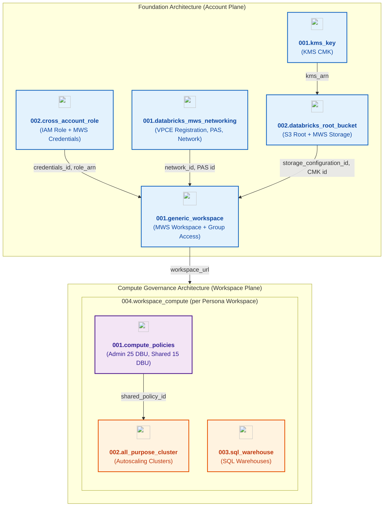
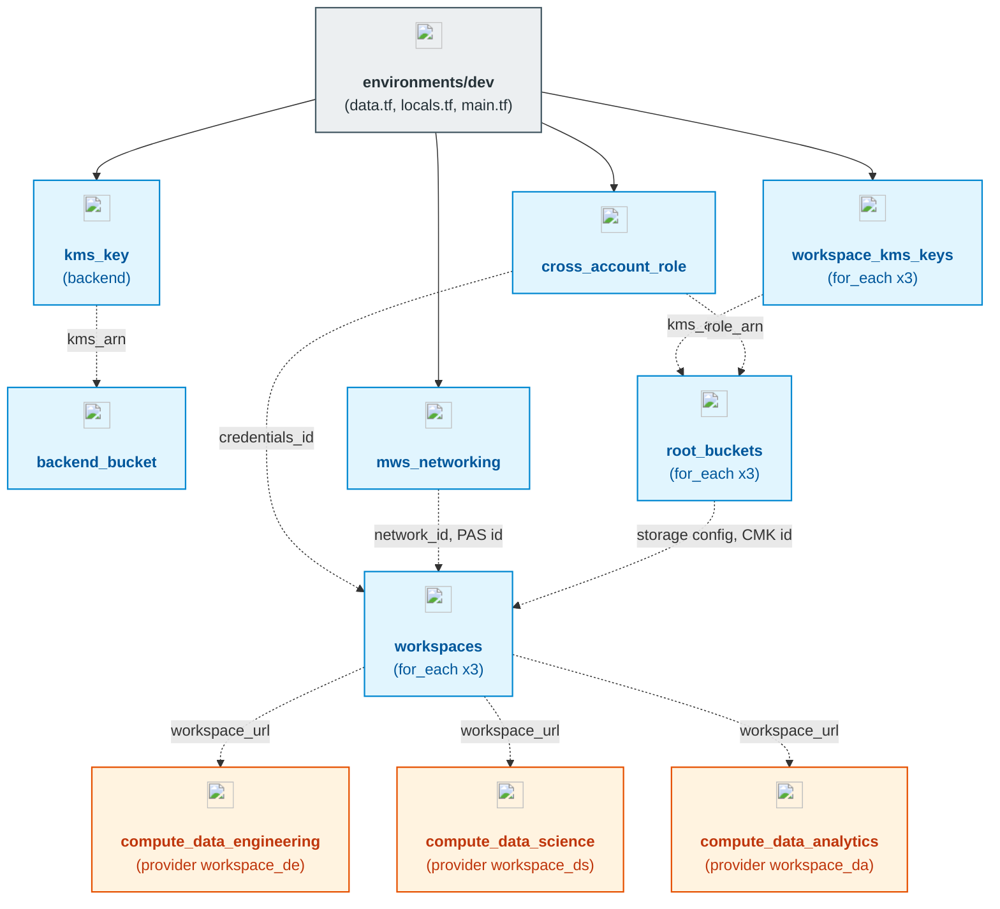

# Databricks on AWS Multi-Workspace & Compute Management (`03_workspaces_and_compute_management`)

[](https://developer.hashicorp.com/terraform/docs)
[](https://registry.terraform.io/providers/hashicorp/aws/latest/docs)
[](https://registry.terraform.io/providers/databricks/databricks/latest/docs)
[](https://registry.terraform.io/providers/hashicorp/time/latest/docs)
[](https://pre-commit.com/)

---

## 1. Executive Summary

- **Purpose & Scope**:
  This repository orchestrates the enterprise-grade deployment of **Databricks E2 multi-workspace architecture and governed compute infrastructure** on Amazon Web Services (AWS). It establishes dedicated, logically isolated Databricks workspaces for three analytics personas—**Data Engineering**, **Data Science**, and **Data Analytics**—on top of the customer-managed Spoke VPC and Control Plane PrivateLink endpoints created in project `01_setup_vpc_networking`, and the account-level groups created in project `02_setup_identity_management`.
- **Problem Statement & Solution**:
  Deploying multi-tenant Databricks environments without strict boundaries leads to resource contention, cost overruns from oversized interactive clusters, and shared credential risks. This project addresses these challenges by implementing:
  - **Account-Level Automation**: Cross-account IAM role and MWS credentials, registration of the existing Spoke VPC and PrivateLink VPC endpoints in the Databricks account, per-workspace customer-managed KMS keys, and S3 root storage buckets registered with Databricks Multi-Workspace Service (MWS).
  - **Persona-Isolated Workspaces**: One Databricks workspace per persona, with `ADMIN` for the platform admin group and `USER` for the persona's account group, assigned through `databricks_mws_permission_assignment`.
  - **Strict Compute Governance**: Cluster policies with a hard **25 DBU/hour cap** for platform administrators and a **15 DBU/hour cap** on shared workspace compute, paired with workload-tailored clusters and auto-stopping SQL Warehouses.
- **Key Business & Security Outcomes**:
  - **End-to-End Encryption**: Customer-managed KMS keys (annual rotation enabled by default) encrypt the Terraform state bucket and each workspace's S3 root storage (registered via `databricks_mws_customer_managed_keys`).
  - **Network Isolation**: Compute runs in the private compute subnets of the customer-managed Spoke VPC; back-end REST API and SCC relay traffic uses AWS PrivateLink interface endpoints registered in the Databricks account.
  - **Cost Predictability**: Cluster policies restrict instance families and DBU burn, and SQL Warehouses auto-stop after idle timeout thresholds.
  - **Modular Architecture**: 10 decoupled, reusable Terraform modules with a clean split between account-level (`databricks.mws`) and workspace-level (`databricks`) resources.

---

## 2. General Architecture & Operational Flow

The provisioning lifecycle is structured across two planes: the **Account Plane** (AWS infrastructure and Databricks MWS registration) and the **Workspace Plane** (in-workspace compute governance, clusters, and warehouses).

### 2.1 Cross-Project Dependencies

[`environments/dev/data.tf`](./environments/dev/data.tf) resolves pre-existing resources by tag/name instead of remote state:

| Source Project | Resource | Lookup |
|:---|:---|:---|
| `01_setup_vpc_networking` | Spoke VPC | `data.aws_vpc.spoke` (`Name = Spoke VPC-<env>`) |
| `01_setup_vpc_networking` | Private compute subnets | `data.aws_subnets.spoke_compute` (`spoke-db-private-<env>-*`) |
| `01_setup_vpc_networking` | Default cluster security group | `data.aws_security_group.spoke_sg` (`default_spoke_sg-<env>`) |
| `01_setup_vpc_networking` (`003.spoke_privatelink`) | Workspace REST API VPC endpoint | `data.aws_vpc_endpoint.databricks_workspace_rest` (`databricks-workspace-vpce-<env>`) |
| `01_setup_vpc_networking` (`003.spoke_privatelink`) | SCC Relay VPC endpoint | `data.aws_vpc_endpoint.databricks_scc_relay` (`databricks-scc-relay-vpce-<env>`) |
| `02_setup_identity_management` | Account groups | `data.databricks_group` for `dbx-platform-admins`, `dbx-data-engineers`, `dbx-data-scientists`, `dbx-data-analysts` |

### 2.2 Provisioning Lifecycle

```text
Project 01 (Networking)                 Project 02 (Identities)
  - Spoke VPC, Subnets, SG                - Account SCIM Groups & Admins
  - PrivateLink VPC Endpoints                     |
         |                                         |
         +--------------------+--------------------+
                              |
                              v
 +----------------------------------------------------------------------+
 |                    FOUNDATION (Account Plane)                        |
 |                                                                      |
 |  1. KMS CMK & S3 Remote State Backend (02.security, 03.storage)      |
 |  2. Cross-Account IAM Role & MWS Credentials (02.security)           |
 |  3. MWS VPC Endpoints, PAS & Network Registration (01.networking)    |
 |  4. Workspace KMS CMKs & S3 Root Storage (02.security, 03.storage)   |
 |  5. MWS Workspaces & Group Access (04.workspaces)                    |
 +----------------------------------------------------------------------+
                              |
                              v  (Workspace URLs resolved)
 +----------------------------------------------------------------------+
 |                 COMPUTE GOVERNANCE (Workspace Plane)                 |
 |                                                                      |
 |  Composite Module: 004.workspace_compute (instantiated per workspace)|
 |  |-- 001.compute_policies    -> Admin (<=25 DBU) & Shared (<=15 DBU) |
 |  |-- 002.all_purpose_cluster -> Autoscaling clusters bound to policy |
 |  +-- 003.sql_warehouse       -> Auto-stopping SQL Warehouses with ACL|
 +----------------------------------------------------------------------+
```

### 2.3 Traffic & Network Connectivity
1. **Control Plane to Data Plane (SCC Relay)**: Clusters initiate outbound TLS connections over port `6666` through the AWS PrivateLink interface endpoint (`databricks-scc-relay-vpce-<env>`) in the Spoke VPC, so worker nodes require no public IP addresses or inbound Internet access.
2. **REST API & Management**: Workspace management operations connect through the private REST interface VPC endpoint (`databricks-workspace-vpce-<env>`) on port `443`.
3. **Private Access Settings**: [`001.databricks_mws_networking`](./modules/01.networking/001.databricks_mws_networking) registers both endpoints with `databricks_mws_vpc_endpoint` and creates `databricks_mws_private_access_settings` (module defaults: `public_access_enabled = true`, `private_access_level = "ACCOUNT"`; with `ENDPOINT` the PAS allow-list is limited to the two registered endpoints).
4. **Storage Access**: Clusters access the dedicated workspace S3 root buckets through the Databricks-generated bucket policy and the cross-account role; KMS grants (`aws_kms_grant`) allow Databricks storage and the cross-account role to use the workspace CMK.

---

## 3. Directory Layout & Module Breakdown

```text
03_workspaces_and_compute_management/
├── .ai/                                 # AI governance: instructions, README template, MCP config, skills
├── .github/                             # GitHub Actions CI/CD workflows, copilot instructions, and skills
├── .pre-commit-config.yaml              # Pre-commit configuration (13 quality hooks)
├── .tflint.hcl                          # TFLint configuration with AWS and Terraform rulesets
├── .trivyignore                         # Trivy vulnerability and misconfiguration exemptions
├── pyproject.toml                       # Python project configuration (pre-commit CLI)
├── environments/
│   └── dev/                             # Development environment root orchestration
│       ├── backend.tf                   # S3 remote state configuration (native lockfile)
│       ├── data.tf                      # AWS & Databricks account data sources
│       ├── locals.tf                    # Persona workspaces, cluster sizing & warehouse specs
│       ├── main.tf                      # Module instantiations for dev environment
│       ├── providers.tf                 # AWS, MWS, and workspace-scoped Databricks providers
│       ├── variables.tf                 # Environment input variables
│       ├── README.md                    # Environment-specific deployment manual
│       └── TERRAFORM.md                 # terraform-docs generated interface
└── modules/
    ├── 01.networking/
    │   └── 001.databricks_mws_networking/  # PrivateLink VPCE registration, PAS & MWS network
    ├── 02.security/
    │   ├── 001.kms_key/                    # Customer-Managed Key (CMK) with rotation
    │   └── 002.cross_account_role/         # Databricks cross-account IAM role + MWS credentials
    ├── 03.storage/
    │   ├── 001.env_backend_bucket/         # Encrypted S3 bucket for Terraform remote state
    │   └── 002.databricks_root_bucket/     # S3 root storage + KMS grants + MWS registration
    ├── 04.workspaces/
    │   └── 001.generic_workspace/          # MWS Workspace & group permission assignments
    └── 05.compute/
        ├── 001.compute_policies/           # Admin policy (<=25 DBU) & Shared policy (<=15 DBU)
        ├── 002.all_purpose_cluster/        # Policy-governed autoscaling compute clusters
        ├── 003.sql_warehouse/              # SQL Warehouses (PRO by default)
        └── 004.workspace_compute/          # Composite orchestrator for policies, clusters & SQL
```

### 3.1 Module Inventory Summary

| Module Path | Primary Resources | Key Deliverables |
|:---|:---|:---|
| [`modules/01.networking/001.databricks_mws_networking`](./modules/01.networking/001.databricks_mws_networking) | `databricks_mws_vpc_endpoint` (REST, relay), `databricks_mws_private_access_settings`, `databricks_mws_networks` | Registers the existing Spoke VPC, subnets, security group and PrivateLink endpoints in the Databricks account; exports `network_id` and `private_access_settings_id` |
| [`modules/02.security/001.kms_key`](./modules/02.security/001.kms_key) | `aws_kms_key`, `aws_kms_key_policy`, `aws_kms_alias` | Hardened customer-managed KMS key with configurable rotation and deletion window; exports `kms_arn` |
| [`modules/02.security/002.cross_account_role`](./modules/02.security/002.cross_account_role) | `aws_iam_role`, `aws_iam_role_policy`, `time_sleep`, `databricks_mws_credentials` | Cross-account role built from `databricks_aws_assume_role_policy` / `databricks_aws_crossaccount_policy`, 30s IAM propagation wait, MWS credentials; exports `role_arn`, `credentials_id` |
| [`modules/03.storage/001.env_backend_bucket`](./modules/03.storage/001.env_backend_bucket) | `aws_s3_bucket`, versioning, SSE-KMS, public access block, ownership controls, lifecycle | S3 remote state backend bucket (SSE-KMS, versioning, public access blocked) |
| [`modules/03.storage/002.databricks_root_bucket`](./modules/03.storage/002.databricks_root_bucket) | `aws_s3_bucket*`, `databricks_aws_bucket_policy`, `aws_kms_grant` (x2), `databricks_mws_customer_managed_keys`, `databricks_mws_storage_configurations` | Workspace root bucket, Databricks bucket policy, KMS grants, CMK registration (`STORAGE` use case) and MWS storage configuration; exports `storage_configuration_id`, `customer_managed_key_id` |
| [`modules/04.workspaces/001.generic_workspace`](./modules/04.workspaces/001.generic_workspace) | `databricks_mws_workspaces`, `databricks_mws_permission_assignment` | Workspace linking credentials, storage, network, PAS and CMK (default `pricing_tier = ENTERPRISE`); `ADMIN` / `USER` group assignments; exports `workspace_url` |
| [`modules/05.compute/001.compute_policies`](./modules/05.compute/001.compute_policies) | `databricks_cluster_policy` (x2), `databricks_permissions` (x2) | Platform Admin policy (<=25 DBU) and Workspace Shared policy (<=15 DBU) with `CAN_USE` ACLs; exports `shared_policy_id` |
| [`modules/05.compute/002.all_purpose_cluster`](./modules/05.compute/002.all_purpose_cluster) | `databricks_cluster`, `databricks_permissions` | Policy-bound autoscaling clusters; admin group `CAN_MANAGE`, user groups `CAN_RESTART` |
| [`modules/05.compute/003.sql_warehouse`](./modules/05.compute/003.sql_warehouse) | `databricks_sql_endpoint`, `databricks_permissions` | SQL Warehouses (default `PRO`, Photon on, 15 min auto-stop); admin group `CAN_MANAGE`, user groups `CAN_USE` |
| [`modules/05.compute/004.workspace_compute`](./modules/05.compute/004.workspace_compute) | Composite (`001`, `002`, `003`) | One instantiation per workspace supporting multiple clusters and SQL warehouses via `for_each` |

---

## 4. Architecture C4 Visualisations

### 4.1 Level 1: System Context Diagram

```mermaid
flowchart TD
    classDef actor fill:#232F3E,stroke:#FF9900,stroke-width:2px,color:#FFFFFF;
    classDef databricks fill:#FF3621,stroke:#B71C1C,stroke-width:2px,color:#FFFFFF;
    classDef aws fill:#1E88E5,stroke:#0D47A1,stroke-width:2px,color:#FFFFFF;
    classDef workspace fill:#E8F5E9,stroke:#2E7D32,stroke-width:2px,color:#1B5E20;
    classDef upstream fill:#ECEFF1,stroke:#455A64,stroke-width:2px,color:#263238;

    Admin["<img src='https://raw.githubusercontent.com/mingrammer/diagrams/master/resources/aws/general/users.png' width='36' height='36' style='width:36px;height:36px;max-width:36px;max-height:36px;display:block;margin:0 auto;object-fit:contain;' /><br/><b>Platform Administrator</b><br/>(dbx-platform-admins)"]:::actor
    DataEng["<img src='https://raw.githubusercontent.com/mingrammer/diagrams/master/resources/aws/general/users.png' width='36' height='36' style='width:36px;height:36px;max-width:36px;max-height:36px;display:block;margin:0 auto;object-fit:contain;' /><br/><b>Data Engineers</b><br/>(dbx-data-engineers)"]:::actor
    DataSci["<img src='https://raw.githubusercontent.com/mingrammer/diagrams/master/resources/aws/general/users.png' width='36' height='36' style='width:36px;height:36px;max-width:36px;max-height:36px;display:block;margin:0 auto;object-fit:contain;' /><br/><b>Data Scientists</b><br/>(dbx-data-scientists)"]:::actor
    DataAnalyst["<img src='https://raw.githubusercontent.com/mingrammer/diagrams/master/resources/aws/general/users.png' width='36' height='36' style='width:36px;height:36px;max-width:36px;max-height:36px;display:block;margin:0 auto;object-fit:contain;' /><br/><b>Data Analysts</b><br/>(dbx-data-analysts)"]:::actor

    subgraph DatabricksE2 ["Databricks E2 SaaS Platform"]
        MWSAccount["<img src='https://raw.githubusercontent.com/oieduardorabelo/databricks-architecture-icons/main/icons/png/data-intelligence-platform.png' width='36' height='36' style='width:36px;height:36px;max-width:36px;max-height:36px;display:block;margin:0 auto;object-fit:contain;' /><br/><b>Databricks Account Console</b><br/>(MWS REST API)"]:::databricks
        ControlPlane["<img src='https://raw.githubusercontent.com/oieduardorabelo/databricks-architecture-icons/main/icons/png/databricks.png' width='36' height='36' style='width:36px;height:36px;max-width:36px;max-height:36px;display:block;margin:0 auto;object-fit:contain;' /><br/><b>Databricks Control Plane</b><br/>(REST API & SCC Relay)"]:::databricks
    end

    subgraph Upstream ["Upstream Projects"]
        Project01["<img src='https://raw.githubusercontent.com/mingrammer/diagrams/master/resources/aws/network/vpc.png' width='32' height='32' style='width:32px;height:32px;max-width:32px;max-height:32px;display:block;margin:0 auto;object-fit:contain;' /><br/><b>01 Networking</b><br/>(Spoke VPC & PrivateLink VPCEs)"]:::upstream
        Project02["<img src='https://raw.githubusercontent.com/oieduardorabelo/databricks-architecture-icons/main/icons/png/abac.png' width='32' height='32' style='width:32px;height:32px;max-width:32px;max-height:32px;display:block;margin:0 auto;object-fit:contain;' /><br/><b>02 Identity Management</b><br/>(Account Groups)"]:::upstream
    end

    subgraph AWSCloud ["Customer AWS Account"]
        subgraph AccountPlane ["Account-Level Foundation"]
            CrossAccountRole["<img src='https://raw.githubusercontent.com/mingrammer/diagrams/master/resources/aws/security/identity-and-access-management-iam.png' width='32' height='32' style='width:32px;height:32px;max-width:32px;max-height:32px;display:block;margin:0 auto;object-fit:contain;' /><br/><b>Cross-Account IAM Role</b>"]:::aws
            MWSNetwork["<img src='https://raw.githubusercontent.com/mingrammer/diagrams/master/resources/aws/network/privatelink.png' width='32' height='32' style='width:32px;height:32px;max-width:32px;max-height:32px;display:block;margin:0 auto;object-fit:contain;' /><br/><b>MWS Network & PAS</b><br/>(PrivateLink)"]:::aws
            KMSKeys["<img src='https://raw.githubusercontent.com/mingrammer/diagrams/master/resources/aws/security/key-management-service.png' width='32' height='32' style='width:32px;height:32px;max-width:32px;max-height:32px;display:block;margin:0 auto;object-fit:contain;' /><br/><b>Customer-Managed KMS Keys</b>"]:::aws
            RootBuckets["<img src='https://raw.githubusercontent.com/mingrammer/diagrams/master/resources/aws/storage/simple-storage-service-s3.png' width='32' height='32' style='width:32px;height:32px;max-width:32px;max-height:32px;display:block;margin:0 auto;object-fit:contain;' /><br/><b>S3 Root Storage Buckets</b>"]:::aws
        end

        subgraph WorkspacesPlane ["Persona-Dedicated Workspaces"]
            WS_DE["<img src='https://raw.githubusercontent.com/oieduardorabelo/databricks-architecture-icons/main/icons/png/workspace.png' width='36' height='36' style='width:36px;height:36px;max-width:36px;max-height:36px;display:block;margin:0 auto;object-fit:contain;' /><br/><b>Workspace</b><br/>(Data Engineering)"]:::workspace
            WS_DS["<img src='https://raw.githubusercontent.com/oieduardorabelo/databricks-architecture-icons/main/icons/png/workspace.png' width='36' height='36' style='width:36px;height:36px;max-width:36px;max-height:36px;display:block;margin:0 auto;object-fit:contain;' /><br/><b>Workspace</b><br/>(Data Science)"]:::workspace
            WS_DA["<img src='https://raw.githubusercontent.com/oieduardorabelo/databricks-architecture-icons/main/icons/png/workspace.png' width='36' height='36' style='width:36px;height:36px;max-width:36px;max-height:36px;display:block;margin:0 auto;object-fit:contain;' /><br/><b>Workspace</b><br/>(Data Analytics)"]:::workspace
        end
    end

    Admin -->|"Account Admin & Governance"| MWSAccount
    DataEng -->|"ETL Pipelines & Jobs"| WS_DE
    DataSci -->|"ML Models & Experiments"| WS_DS
    DataAnalyst -->|"SQL & Dashboards"| WS_DA

    Project01 -.->|"VPC, Subnets, SG, VPCE IDs"| MWSNetwork
    Project02 -.->|"Account Group IDs"| WorkspacesPlane
    MWSAccount -->|"Assumes Role (External ID)"| CrossAccountRole
    MWSNetwork --> WorkspacesPlane
    KMSKeys --> RootBuckets
    RootBuckets --> WorkspacesPlane
    ControlPlane <-->|"SCC Relay & REST (PrivateLink)"| WorkspacesPlane
```



### 4.2 Level 2: Deployment & Component Diagram



### 4.3 Level 3: Terraform Orchestration (`environments/dev`)



---

## 5. Compute Policy & Workload Governance Matrix

Every workspace deploys the capped **Platform Admin** policy alongside the **Workspace Shared** policy; clusters (default policy: Workspace Shared) and SQL Warehouses are tailored to each persona via [`environments/dev/locals.tf`](./environments/dev/locals.tf):

| Policy / Workload | Scope / Target Workspace | Core Constraints & Rules | Allowed Instance Families | Group RBAC |
|:---|:---|:---|:---|:---|
| **Platform Admin Policy** | All Workspaces | **Max 25 DBUs/hr**, autoscale max 4 workers (default 2), max 45 min idle timeout (default 30), elastic disk fixed on, `PHOTON`/`STANDARD`, `USER_ISOLATION`/`SINGLE_USER` | `m5`, `m6i`, `c5`, `c6i`, `r5`, `r6i`, `i3`, `i4i` (`.xlarge`, `.2xlarge`); default `m5.xlarge` | `CAN_USE` for `dbx-platform-admins` |
| **Workspace Shared Policy** | All Workspaces | **Max 15 DBUs/hr**, autoscale min fixed at 1, max 4 workers (default 2), max 30 min idle timeout (default 20), elastic disk fixed on, ML LTS runtimes allowed | Same allowlist as Platform Admin policy | `CAN_USE` for `dbx-platform-admins` & workspace user groups |
| **Data Engineering Compute** | `data_engineering` | ETL cluster `de-etl-cluster-dev` (1–3 workers, `18.x-scala2.13`, 30 min idle) + SQL Warehouse `de-sql-warehouse-dev` (`2X-Small`, 15 min auto-stop) | `m5.xlarge` | Admin `CAN_MANAGE`; `dbx-data-engineers`: `CAN_RESTART` (cluster) / `CAN_USE` (warehouse) |
| **Data Science Compute** | `data_science` | ML cluster `ds-ml-cluster-dev` (1–2 workers, `18.x-scala2.13`, 20 min idle); no SQL Warehouses | `m5.xlarge` | Admin `CAN_MANAGE`; `dbx-data-scientists`: `CAN_RESTART` |
| **Data Analytics Compute** | `data_analytics` | BI SQL Warehouse `da-bi-warehouse-dev` (`X-Small`, 10 min auto-stop); no clusters | `X-Small` SQL Warehouse | Admin `CAN_MANAGE`; `dbx-data-analysts`: `CAN_USE` |

---

## 6. Deployment Runbook

The project is architected for unified single-pass plan and apply in either the local terminal or automated GitHub Actions CI/CD workflows.

### Prerequisites
- AWS CLI profile with administrator privileges for the target account (`profile` variable; the S3 backend in [`backend.tf`](./environments/dev/backend.tf) uses its own profile).
- Databricks account service principal OAuth credentials (`service_principal_id`, `service_principal_secret`) and `databricks_account_id`.
- Projects `01_setup_vpc_networking` (Spoke VPC and PrivateLink endpoints) and `02_setup_identity_management` (account groups) already applied.
- Terraform `>= 1.5.0` and the `uv` package manager installed.

### Execution Steps

```bash
cd environments/dev
terraform init

# 1. Speculative Execution Plan
terraform plan -out=tfplan

# 2. Infrastructure & Compute Apply
terraform apply tfplan
```

> [!CAUTION]
> `terraform apply` must only be run with explicit approval.

---

## 7. Quality Assurance & Pre-Commit Validation

The repository enforces an automated 13-hook quality gate across Terraform, security, and repository hygiene:

```bash
# Run all pre-commit hooks via uv
uv run pre-commit run --all-files
```

| Quality Hook | Tool / Engine | Purpose |
|:---|:---|:---|
| `trailing-whitespace` | pre-commit-hooks v5.0.0 | Strips trailing whitespace characters |
| `end-of-file-fixer` | pre-commit-hooks v5.0.0 | Enforces Unix newline at end of files |
| `check-yaml` | pre-commit-hooks v5.0.0 | Validates YAML syntax |
| `check-json` | pre-commit-hooks v5.0.0 | Validates JSON syntax |
| `check-merge-conflict` | pre-commit-hooks v5.0.0 | Prevents committing unresolved merge conflicts |
| `detect-aws-credentials` | pre-commit-hooks v5.0.0 | Prevents leaking AWS credentials |
| `gitleaks` | Gitleaks v8.21.2 | Deep secret and token scanning |
| `terraform_fmt` | pre-commit-terraform v1.96.2 | Enforces canonical HCL style formatting |
| `terraform_validate` (modules) | pre-commit-terraform v1.96.2 | Validates standalone reusable modules |
| `terraform_validate` (environments) | pre-commit-terraform v1.96.2 | Validates root environment configurations |
| `terraform_tflint` | TFLint (`terraform` recommended + AWS ruleset 0.38.0) | Linting, unused variables, and best practices |
| `terraform_trivy` | Trivy | Scans for misconfigurations (exemptions documented in [`.trivyignore`](./.trivyignore)) |
| `terraform_docs` | terraform-docs | Automatically updates module `TERRAFORM.md` files |

---

## 8. Important Links and Resources

### 8.1 Authoritative Databricks Documentation
- [Databricks AWS Workspace Terraform Guide](https://registry.terraform.io/providers/databricks/databricks/latest/docs/guides/aws-workspace) - Step-by-step guide for deploying E2 workspaces.
- [Databricks AWS PrivateLink Workspace Guide](https://registry.terraform.io/providers/databricks/databricks/latest/docs/guides/aws-private-link-workspace) - VPC endpoint registration, private access settings, and workspace provisioning.
- [Databricks Classic Private Connectivity](https://docs.databricks.com/aws/en/security/network/classic/privatelink) - Back-end PrivateLink for the classic compute plane.
- [Databricks on AWS Workspace Administration Guide](https://docs.databricks.com/aws/en/admin/workspace/) - Workspace lifecycle and administration.
- [Databricks Cluster Policies](https://docs.databricks.com/aws/en/admin/clusters/policies) - Policy definition reference.
- [Databricks Terraform Provider Documentation](https://registry.terraform.io/providers/databricks/databricks/latest/docs) - Provider resources and data sources.

### 8.2 Authoritative AWS Documentation
- [AWS Official Documentation](https://docs.aws.amazon.com/) - Main portal for AWS service specifications.
- [AWS Well-Architected Framework](https://aws.amazon.com/architecture/well-architected/) - Security, reliability, and operational guidance.

### 8.3 Icon Libraries & Tooling
- [`oieduardorabelo/databricks-architecture-icons`](https://oieduardorabelo.github.io/databricks-architecture-icons/) - 71 Databricks product icons built from official Databricks artwork.
- [`mingrammer/diagrams`](https://github.com/mingrammer/diagrams) - AWS architecture icon set.
- [terraform-docs Documentation](https://terraform-docs.io/) - Tool generating each `TERRAFORM.md`.

### 8.4 Internal Repository References
- [Environment Documentation](./environments/dev/README.md)
- [Project Instructions & Source of Truth](./.ai/instructions.md)
- [Authoritative README Template](./.ai/README_TEMPLATE.md)
