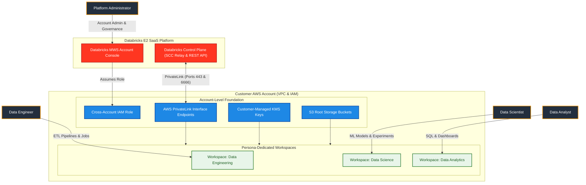
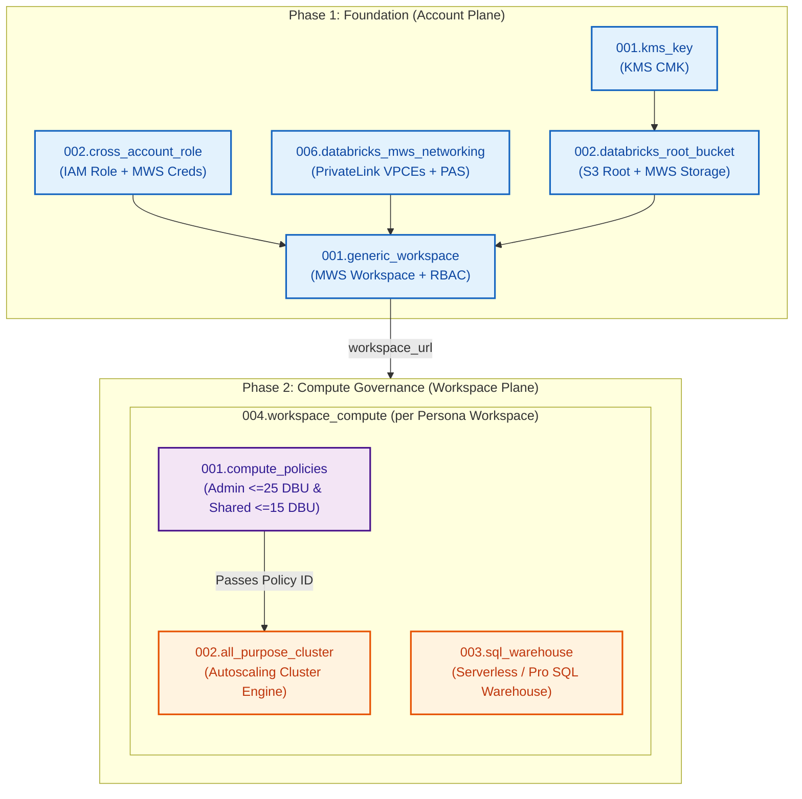

# Databricks on AWS Multi-Workspace & Compute Management (`03_workspaces_and_compute_management`)

[](https://developer.hashicorp.com/terraform/docs)
[](https://registry.terraform.io/providers/hashicorp/aws/latest/docs)
[](https://registry.terraform.io/providers/databricks/databricks/latest/docs)
[](https://registry.terraform.io/providers/hashicorp/time/latest/docs)
[](https://pre-commit.com/)

---

## 1. Executive Summary

- **Purpose & Scope**:
  This repository orchestrates the enterprise-grade deployment of **Databricks E2 multi-workspace architecture and governed compute infrastructure** on Amazon Web Services (AWS). It establishes dedicated, logically isolated Databricks workspaces for three core analytics personas—**Data Engineering**, **Data Science**, and **Data Analytics**—within a customer-managed AWS VPC environment.
- **Problem Statement & Solution**:
  Deploying multi-tenant Databricks environments without strict boundaries leads to resource contention, cost overruns from oversized interactive clusters, and shared credential risks. This project addresses these challenges by implementing:
  - **Account-Level Automation**: Automatic provisioning of cross-account IAM roles, AWS PrivateLink interface endpoints, dedicated customer-managed KMS encryption keys, and S3 root storage buckets registered with Databricks Multi-Workspace Service (MWS).
  - **Persona-Isolated Workspaces**: Discrete workspaces tailored to operational personas with role-based access control (RBAC).
  - **Strict Compute Governance**: Enforced cluster policies—featuring a hard **25 DBU/hour budget cap** for platform administrators and a **15 DBU/hour cap** on shared workspace compute, paired with workload-tailored clusters and auto-stopping SQL Warehouses.
- **Key Business & Security Outcomes**:
  - **End-to-End Encryption**: Dedicated Customer-Managed Keys (CMK) with annual rotation encrypting Terraform state, S3 root storage buckets, and DBFS storage.
  - **Network Isolation**: Complete PrivateLink connectivity for Workspace REST APIs and Secure Cluster Connectivity (SCC) Relay traffic.
  - **Cost Predictability**: Cluster policies prevent provisioning unbounded or unapproved EC2 instance families, while SQL Warehouses automatically stop after idle timeout thresholds.
  - **Modular Architecture**: 10 decoupled, reusable Terraform modules adhering to clean separation of concerns between account-level control plane and workspace-level data plane resources.

---

## 2. General Architecture & Operational Flow

The provisioning lifecycle is structured across two distinct planes: the **Account Plane** (AWS infrastructure and Databricks MWS registration) and the **Workspace Plane** (in-workspace compute governance, clusters, and warehouses).

### 2.1 Two-Phase Architecture Lifecycle

```text
Project 01 (Networking)           Project 02 (Identities)
  - Spoke VPC, Subnets, SG          - Account SCIM Groups & Admins
         │                                       │
         └───────────────────┬───────────────────┘
                             │
                             ▼
 ┌────────────────────────────────────────────────────────────────────────┐
 │                   PHASE 1: FOUNDATION (Account Plane)                  │
 │                                                                        │
 │  1. KMS CMK & S3 Remote State Backend (modules/02.security, 03.storage)│
 │  2. Cross-Account IAM Role & MWS Credentials (modules/02.security)     │
 │  3. PrivateLink VPCEs & MWS Network Config (modules/01.networking)    │
 │  4. Workspace KMS CMKs & S3 Root Storage (modules/02.security, storage)│
 │  5. Generic MWS Workspaces & Group Access (modules/04.workspaces)      │
 └───────────────────────────────────┬────────────────────────────────────┘
                                     │
                                     ▼ (Workspace URLs Resolved)
 ┌────────────────────────────────────────────────────────────────────────┐
 │               PHASE 2: COMPUTE GOVERNANCE (Workspace Plane)            │
 │                                                                        │
 │  Composite Module: 004.workspace_compute (Instantiated per Workspace)  │
 │  ├── 001.compute_policies  ──> Admin (<=25 DBU) & Shared Policy (<=15 DBU) │
 │  ├── 002.all_purpose_cluster ──> Auto-scaling clusters bound to policy │
 │  └── 003.sql_warehouse      ──> Auto-stopping BI Warehouses with ACLs  │
 └────────────────────────────────────────────────────────────────────────┘
```

### 2.2 Traffic & Network Connectivity
1. **Control Plane to Data Plane (SCC Relay)**: Clusters initiate outbound TLS connections over port `6666` via the AWS PrivateLink Interface Endpoint (`relay_vpce`), ensuring worker nodes require zero public IP addresses or inbound Internet access.
2. **REST API & Management**: Workspace management operations connect through the private REST interface VPC endpoint (`workspace_vpce`) on port `443`.
3. **Storage Access**: Compute clusters access the dedicated workspace S3 root bucket using IAM instance profiles and customer-managed KMS key decryption grants.

---

## 3. Directory Layout & Module Breakdown

```text
03_workspaces_and_compute_management/
├── .pre-commit-config.yaml              # Pre-commit configuration (13 quality hooks)
├── .tflint.hcl                          # TFLint configuration with AWS and Terraform rulesets
├── .trivyignore                         # Trivy vulnerability and misconfiguration exemptions
├── pyproject.toml                       # Python project configuration (pre-commit CLI)
├── environments/
│   └── dev/                             # Development environment root orchestration
│       ├── backend.tf                   # S3 remote state configuration
│       ├── data.tf                      # AWS & Databricks account data sources
│       ├── locals.tf                    # Persona workspaces, cluster sizing & warehouse specs
│       ├── main.tf                      # Module instantiations for dev environment
│       ├── providers.tf                 # AWS, MWS, and workspace-scoped Databricks providers
│       ├── variables.tf                 # Environment input variables
│       └── README.md                    # Environment-specific deployment manual
└── modules/
    ├── 01.networking/
    │   └── 006.databricks_mws_networking/  # AWS PrivateLink VPCEs, PAS & MWS Network
    ├── 02.security/
    │   ├── 001.kms_key/                    # Customer-Managed Key (CMK) with annual rotation
    │   └── 002.cross_account_role/         # Databricks cross-account IAM role + credentials
    ├── 03.storage/
    │   ├── 001.env_backend_bucket/         # Encrypted S3 bucket for Terraform remote state
    │   └── 002.databricks_root_bucket/     # S3 root storage + CMK encryption + MWS registration
    ├── 04.workspaces/
    │   └── 001.generic_workspace/          # Databricks MWS Workspace & group role assignments
    └── 05.compute/
        ├── 001.compute_policies/           # Capped Admin policy (<=25 DBU) & Shared policy (<=15 DBU)
        ├── 002.all_purpose_cluster/        # Policy-governed autoscaling compute clusters
        ├── 003.sql_warehouse/              # Cost-optimized Serverless/Pro SQL Warehouses
        └── 004.workspace_compute/          # Composite orchestrator binding policies, clusters & SQL
```

### 3.1 Module Inventory Summary

| Module Path | Primary Resources | Key Deliverables |
|:---|:---|:---|
| [`modules/01.networking/006.databricks_mws_networking`](file:///modules/01.networking/006.databricks_mws_networking) | `aws_vpc_endpoint`, `aws_security_group`, `databricks_mws_networks`, `databricks_mws_private_access_settings` | Dual PrivateLink VPCEs (REST/Relay), VPCE security group, PAS, and Databricks network registration |
| [`modules/02.security/001.kms_key`](file:///modules/02.security/001.kms_key) | `aws_kms_key`, `aws_kms_key_policy`, `aws_kms_alias` | Hardened customer-managed KMS key with annual rotation and IAM delegation |
| [`modules/02.security/002.cross_account_role`](file:///modules/02.security/002.cross_account_role) | `aws_iam_role`, `aws_iam_policy`, `time_sleep`, `databricks_mws_credentials` | Cross-account role, assume role policy with External ID, 30s STS propagation sleep, MWS credentials |
| [`modules/03.storage/001.env_backend_bucket`](file:///modules/03.storage/001.env_backend_bucket) | `aws_s3_bucket`, `aws_s3_bucket_server_side_encryption_configuration`, `aws_s3_bucket_public_access_block` | S3 remote state backend bucket with SSE-KMS, versioning, and public access blocks |
| [`modules/03.storage/002.databricks_root_bucket`](file:///modules/03.storage/002.databricks_root_bucket) | `aws_s3_bucket`, `aws_s3_bucket_policy`, `databricks_mws_customer_managed_keys`, `databricks_mws_storage_configurations` | Workspace root storage bucket, Databricks bucket policy, CMK registration, and MWS storage configuration |
| [`modules/04.workspaces/001.generic_workspace`](file:///modules/04.workspaces/001.generic_workspace) | `databricks_mws_workspaces`, `databricks_mws_permission_assignment` | Encapsulated workspace provisioning linking credentials, storage, network, and KMS; group RBAC assignments |
| [`modules/05.compute/001.compute_policies`](file:///modules/05.compute/001.compute_policies) | `databricks_cluster_policy`, `databricks_permissions` | Capped Platform Admin policy (<=25 DBU cap) and Workspace Shared policy (<=15 DBU cap) with group ACLs |
| [`modules/05.compute/002.all_purpose_cluster`](file:///modules/05.compute/002.all_purpose_cluster) | `databricks_cluster`, `databricks_permissions` | Policy-bound autoscaling interactive clusters with autotermination and permissions |
| [`modules/05.compute/003.sql_warehouse`](file:///modules/05.compute/003.sql_warehouse) | `databricks_sql_endpoint`, `databricks_permissions` | Serverless/Pro SQL Warehouses with configurable auto-stop and group access controls |
| [`modules/05.compute/004.workspace_compute`](file:///modules/05.compute/004.workspace_compute) | Composite (`001`, `002`, `003` submodules) | Single unified workspace compute instantiation supporting multiple clusters and SQL endpoints per workspace |

---

## 4. Architecture C4 Visualisations

### 4.1 Level 1: System Context Diagram



### 4.2 Level 2: Deployment & Component Diagram



---

## 5. Compute Policy & Workload Governance Matrix

Every workspace automatically deploys the capped **Platform Admin** policy alongside the **Workspace Shared** policy, with clusters and SQL Warehouses tailored to each workload:

| Policy / Workload | Scope / Target Workspace | Core Constraints & Rules | Allowed Instance Families | Group RBAC |
|:---|:---|:---|:---|:---|
| **Platform Admin Policy** | All Workspaces | **Max 25 DBUs/hr budget cap**, max 4 workers, max 45 min idle timeout | `m5.large`, `m5.xlarge`, `m5.2xlarge`, `c5.xlarge`, `c5.2xlarge`, `r5.xlarge`, `r5.2xlarge` | `CAN_USE` for `dbx-platform-admins` |
| **Workspace Shared Policy** | All Workspaces | **Max 15 DBUs/hr budget cap**, auto-scaling 1–4 workers, max 30 min idle timeout | `m5.large`, `m5.xlarge`, `m5.2xlarge`, `i3.xlarge`, `r5.xlarge` | `CAN_USE` for `dbx-platform-admins` & workspace user groups |
| **Data Engineering Compute** | `data_engineering` | ETL cluster (`de-etl-cluster-dev`, 1–3 workers, 30 min idle timeout) + SQL Warehouse (`de-sql-warehouse-dev`, `2X-Small`, 15 min auto-stop) | `m5.large` | `CAN_RESTART`/`CAN_USE` for `dbx-data-engineers` |
| **Data Science Compute** | `data_science` | ML cluster (`ds-ml-cluster-dev`, 1–2 workers, ML runtime, 20 min idle timeout) | `m5.xlarge` | `CAN_RESTART` for `dbx-data-scientists` |
| **Data Analytics Compute** | `data_analytics` | BI SQL Warehouse (`da-bi-warehouse-dev`, `X-Small`, 10 min auto-stop) | `X-Small` SQL Warehouse | `CAN_USE` for `dbx-data-analysts` |

---

## 6. Staged Deployment Runbook

Because workspace-scoped providers require live workspace URLs generated during workspace creation, initial deployment follows a clean two-stage apply sequence:

### Prerequisites
- AWS CLI configured with administrator privileges (`profile = "sandbox"`).
- Databricks Account Administrator OAuth credentials (`DATABRICKS_CLIENT_ID`, `DATABRICKS_CLIENT_SECRET`, `DATABRICKS_ACCOUNT_ID`).
- Terraform `>= 1.5.0` and `uv` package manager installed.

### Stage 1: Foundation Deployment (Account Plane)
Provisions the state backend, cross-account credentials, PrivateLink networking, root storage, and creates the Databricks workspaces:

```bash
cd environments/dev
terraform init

terraform apply \
  -target="module.kms_key" \
  -target="module.backend_bucket" \
  -target="module.cross_account_role" \
  -target="module.mws_networking" \
  -target="module.workspace_kms_keys" \
  -target="module.root_buckets" \
  -target="module.workspaces"
```

### Stage 2: Compute & Governance Convergence (Workspace Plane)
Deploys cluster policies, policy-governed compute clusters, and SQL Warehouses into each initialized workspace:

```bash
terraform apply
```

---

## 7. Quality Assurance & Pre-Commit Validation

This repository enforces an automated 13-hook quality gate across Terraform, security, and repository hygiene:

```bash
# Run all pre-commit hooks via uv
uv run pre-commit run --all-files
```

| Quality Hook | Tool / Engine | Purpose | Status |
|:---|:---|:---|:---:|
| `trailing-whitespace` | pre-commit | Strips trailing whitespace characters | Passed |
| `end-of-file-fixer` | pre-commit | Enforces Unix newline at end of files | Passed |
| `check-yaml` | pre-commit | Validates YAML syntax | Passed |
| `check-json` | pre-commit | Validates JSON syntax | Passed |
| `check-merge-conflict` | pre-commit | Prevents committing unresolved merge conflicts | Passed |
| `detect-aws-credentials` | pre-commit | Prevents leaking AWS credentials | Passed |
| `gitleaks` | Gitleaks v8.21.2 | Deep secret and token scanning | Passed |
| `terraform_fmt` | Terraform CLI | Enforces canonical HCL style formatting | Passed |
| `terraform_validate (modules)` | Terraform CLI | Validates standalone reusable modules | Passed |
| `terraform_validate (environments)` | Terraform CLI | Validates root environment configurations | Passed |
| `terraform_tflint` | TFLint | Enforces linting, unused variables, and best practices | Passed |
| `terraform_trivy` | Trivy v0.74.0 | Scans for High/Critical misconfigurations | Passed |
| `terraform_docs` | Terraform-Docs | Automatically updates module `TERRAFORM.md` files | Passed |
