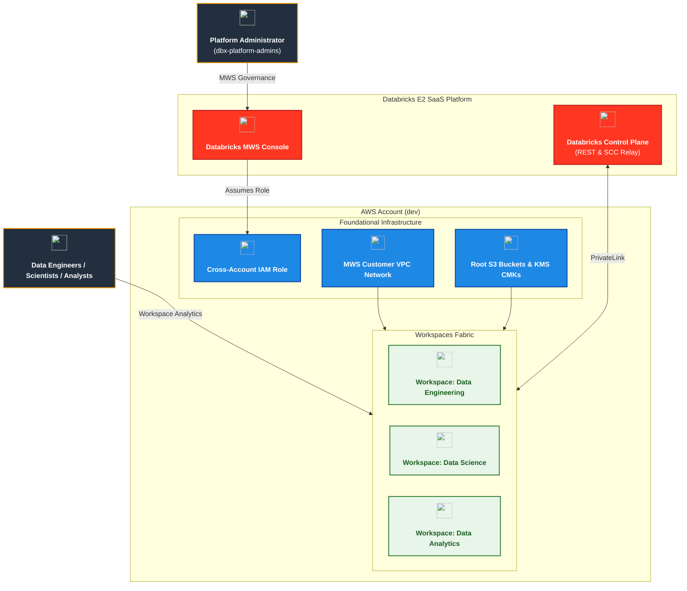

# Databricks Multi-Workspace and Compute Management - Dev Environment (`environments/dev`)

[](https://developer.hashicorp.com/terraform/docs)
[](https://registry.terraform.io/providers/hashicorp/aws/latest/docs)
[](https://registry.terraform.io/providers/databricks/databricks/latest/docs)
[](https://registry.terraform.io/providers/hashicorp/time/latest/docs)

---

## 1. Executive Summary

- **Purpose & Scope**:
  This environment orchestrates the complete end-to-end provisioning of dedicated Databricks workspaces and governed compute infrastructure for **Data Engineering**, **Data Science**, and **Data Analytics** personas in the `dev` environment. It builds on the networking foundation established in project `01_setup_vpc_networking` (customer-managed Spoke VPC, private compute subnets, cluster security group, and back-end PrivateLink endpoints) and the account identity governance established in project `02_setup_identity_management` (SCIM groups).
- **Problem Statement & Solution**:
  Deploying multiple Databricks workspaces in an enterprise environment requires orchestrating account-level resources (cross-account IAM roles, customer-managed VPC network registration, S3 root storage, KMS customer-managed keys) alongside workspace-level compute engines. This environment delivers a clean, modular design orchestrating foundational AWS/Databricks MWS resources, persona workspaces, and compute governance within a unified, reproducible configuration.
- **Key Business & Security Outcomes**:
  - **AWS & Account Foundation**: Dedicated cross-account IAM role with AWS STS propagation protection (`time_sleep` 30s), registration of the customer-managed Spoke VPC and PrivateLink endpoints in Databricks MWS, and encrypted state persistence.
  - **Isolated Storage**: Dedicated Amazon S3 root storage buckets per workspace, each encrypted with an independent customer-managed KMS key (annual rotation) and registered with Databricks MWS.
  - **Multi-Workspace Fabric**: Discrete Databricks workspaces for `data_engineering`, `data_science`, and `data_analytics` personas with authoritative access assignments (`ADMIN` for platform admins, `USER` for persona groups).
  - **Strict Compute Governance**: Enforced cluster policies—including a Platform Admin policy capped at **maximum 25 DBUs/hr** and a Shared Workspace policy capped at **maximum 15 DBUs/hr**—ensuring no unconstrained clusters can be launched.
  - **Configured Workloads**: Automated autoscaling compute clusters and cost-optimized SQL Warehouses orchestrated via a single composite module instantiated per workspace.

---

## 2. General Logic & Operational Flow

### 2.1 Configuration & Dependency Lifecycle

```text
Project 01 (Spoke VPC, Subnets, SG, VPCEs)  ──>  AWS Data Lookups (data.tf)
Project 02 (Account Groups)                ──>  Databricks Data Lookups (data.tf)
                                                        │
                                                        ▼
         ┌──────────────────────────────────────────────────────────────┐
         │              Foundation Layer (Account Plane)                │
         │  - S3 Backend & KMS Key                                      │
         │  - Cross-Account IAM Role (with 30s sleep)                   │
         │  - Customer-Managed Spoke VPC Network & PAS in MWS           │
         │  - Dedicated Workspace KMS Keys & Root S3 Buckets            │
         │  - Generic MWS Workspaces & Group Role Assignments           │
         └──────────────────────────────┬───────────────────────────────┘
                                        │ (Workspace URLs Generated)
                                        ▼
         ┌──────────────────────────────────────────────────────────────┐
         │         Compute Governance Layer (Workspace Plane)           │
         │  Composite Module: 004.workspace_compute (Instantiated 3x)   │
         │  - Compute Policies (Admin <=25 DBU & Shared <=15 DBU)       │
         │  - All-Purpose Compute Clusters (tied to policy IDs)         │
         │  - SQL Warehouses (with inactivity auto-stop)                │
         └──────────────────────────────────────────────────────────────┘
```

### 2.2 Network & Traffic Flow
- **Customer-Managed VPC**: Compute planes reside within the Spoke VPC provisioned in project `01_setup_vpc_networking`.
- **Outbound Egress (Databricks Clusters -> SCC Relay)**:
  `[Databricks Compute Cluster]` $\rightarrow$ `[Private Subnet]` $\rightarrow$ `[AWS Interface VPCE: backend_relay]` $\rightarrow$ `[Databricks Control Plane (Port 6666)]`.
- **REST API Management**:
  `[Terraform / Developer]` $\rightarrow$ `[AWS Interface VPCE: backend_rest]` $\rightarrow$ `[Databricks Control Plane (Port 443)]`.
- **Data Storage**:
  `[Compute Clusters]` $\rightarrow$ `[AWS S3 Root Bucket]` $\rightarrow$ `[SSE-KMS Encryption]`.

---

## 3. Architecture of the Dev Environment

### 3.1 Network Topology & Integration
This environment imports existing network infrastructure provisioned by project `01_setup_vpc_networking`:

| Resource Type | Source | Purpose |
|:---|:---|:---|
| `vpc_id` | `data.aws_vpc.spoke` | Customer-managed Spoke VPC (`Spoke VPC-dev`) |
| `subnet_ids` | `data.aws_subnets.spoke_compute` | Private compute subnets (`spoke-db-private-dev-*`) across AZs |
| `security_group_ids` | `data.aws_security_group.spoke_sg` | Default Spoke cluster security group (`default_spoke_sg-dev`) |
| `workspace_vpce_id` | `data.aws_vpc_endpoint.databricks_workspace_rest` | Back-end Workspace REST API Interface VPC Endpoint (`databricks-workspace-vpce-dev`) |
| `relay_vpce_id` | `data.aws_vpc_endpoint.databricks_scc_relay` | Back-end SCC Relay Interface VPC Endpoint (`databricks-scc-relay-vpce-dev`) |

### 3.2 Security, IAM & Encryption Posture
- **Encryption at Rest**:
  - Remote state bucket encrypted with dedicated KMS CMK (`alias/dbx_workspaces_compute_backend_kms_key`).
  - Each workspace has a dedicated KMS CMK (`alias/dbx_de_root_kms`, `alias/dbx_ds_root_kms`, `alias/dbx_da_root_kms`) with automatic annual key rotation and root account delegation.
- **Cross-Account Access**:
  - Dedicated IAM role assumed by Databricks Account (`414351767826`) with conditional External ID verification matching the Databricks Account ID.
  - 30-second sleep buffer to prevent STS eventual consistency race conditions during MWS registration.

---

## 4. Architecture C4 Visualisations

### 4.1 Level 1: System Context Diagram



### 4.2 Level 2: Component Architecture Diagram

```mermaid
flowchart TD
    classDef infra fill:#E3F2FD,stroke:#1565C0,stroke-width:2px,color:#0D47A1;
    classDef compute fill:#FFF3E0,stroke:#E65100,stroke-width:2px,color:#BF360C;
    classDef policy fill:#F3E5F5,stroke:#4A148C,stroke-width:2px,color:#311B92;

    subgraph DevEnv ["environments/dev"]
        subgraph FoundationModules ["Foundation Modules (Account Plane)"]
            KmsKey["<img src='https://raw.githubusercontent.com/mingrammer/diagrams/master/resources/aws/security/key-management-service.png' width='28' height='28' style='width:28px;height:28px;max-width:28px;max-height:28px;display:block;margin:0 auto;object-fit:contain;' /><br/><b>001.kms_key</b>"]:::infra
            CrossAccount["<img src='https://raw.githubusercontent.com/mingrammer/diagrams/master/resources/aws/security/identity-and-access-management-iam.png' width='28' height='28' style='width:28px;height:28px;max-width:28px;max-height:28px;display:block;margin:0 auto;object-fit:contain;' /><br/><b>002.cross_account_role</b>"]:::infra
            Networking["<img src='https://raw.githubusercontent.com/mingrammer/diagrams/master/resources/aws/network/privatelink.png' width='28' height='28' style='width:28px;height:28px;max-width:28px;max-height:28px;display:block;margin:0 auto;object-fit:contain;' /><br/><b>001.databricks_mws_networking</b>"]:::infra
            RootBuckets["<img src='https://raw.githubusercontent.com/mingrammer/diagrams/master/resources/aws/storage/simple-storage-service-s3.png' width='28' height='28' style='width:28px;height:28px;max-width:28px;max-height:28px;display:block;margin:0 auto;object-fit:contain;' /><br/><b>002.databricks_root_bucket (3x)</b>"]:::infra
            WorkspacesMod["<img src='https://raw.githubusercontent.com/oieduardorabelo/databricks-architecture-icons/main/icons/png/workspace.png' width='28' height='28' style='width:28px;height:28px;max-width:28px;max-height:28px;display:block;margin:0 auto;object-fit:contain;' /><br/><b>001.generic_workspace (3x)</b>"]:::infra
        end

        subgraph ComputeModules ["Compute Governance Modules (Workspace Plane)"]
            subgraph CompositeCompute ["004.workspace_compute (Instantiated 3x)"]
                Policies["<img src='https://raw.githubusercontent.com/oieduardorabelo/databricks-architecture-icons/main/icons/png/enterprise-security.png' width='28' height='28' style='width:28px;height:28px;max-width:28px;max-height:28px;display:block;margin:0 auto;object-fit:contain;' /><br/><b>001.compute_policies</b>"]:::policy
                Clusters["<img src='https://raw.githubusercontent.com/oieduardorabelo/databricks-architecture-icons/main/icons/png/compute-clusters.png' width='28' height='28' style='width:28px;height:28px;max-width:28px;max-height:28px;display:block;margin:0 auto;object-fit:contain;' /><br/><b>002.all_purpose_cluster</b>"]:::compute
                SQLWarehouses["<img src='https://raw.githubusercontent.com/oieduardorabelo/databricks-architecture-icons/main/icons/png/sql-warehouse.png' width='28' height='28' style='width:28px;height:28px;max-width:28px;max-height:28px;display:block;margin:0 auto;object-fit:contain;' /><br/><b>003.sql_warehouse</b>"]:::compute
            end
        end

        CrossAccount --> WorkspacesMod
        Networking --> WorkspacesMod
        RootBuckets --> WorkspacesMod
        WorkspacesMod -->|"workspace_url"| CompositeCompute
    end
```



---

## 5. Provisioning Sequence & Deployment Runbook

The environment is architected for unified single-pass plan and apply in either the local terminal or automated GitHub Actions CI/CD workflows:

```bash
# Initialize Terraform and provider plugins
terraform init

# Speculative Execution Plan
terraform plan -out=tfplan

# Apply Infrastructure and Compute Governance
terraform apply tfplan
```

---

## 6. Compute Policy & Workload Governance Matrix

All workspaces deploy the capped **Platform Admin** policy alongside the **Workspace Shared** policy, with clusters and SQL Warehouses tailored to each workload:

| Policy / Workload | Scope / Target Workspace | Core Constraints | Group Permissions |
|:---|:---|:---|:---|
| **Platform Admin Policy** | All Workspaces | **Max 25 DBUs/hr budget cap**, max 4 workers, cost-efficient instance types (`m5.xlarge`, `m5.2xlarge`, `c5.xlarge`, `c5.2xlarge`, `r5.xlarge`, `r5.2xlarge`, `i3.xlarge`, etc.), max 45 min idle timeout | `CAN_USE` for `dbx-platform-admins` |
| **Workspace Shared Policy** | All Workspaces | **Max 15 DBUs/hr budget cap**, auto-scaling 1–4 workers, max 30 min idle timeout | `CAN_USE` for `dbx-platform-admins` & workspace user groups |
| **Data Engineering Compute** | `data_engineering` | ETL cluster (`de-etl-cluster-dev`, 1–3 workers, `m5.xlarge`, `18.x-scala2.13`, 30 min idle timeout) + SQL Warehouse (`de-sql-warehouse-dev`, `2X-Small`, 15 min auto-stop) | `CAN_RESTART`/`CAN_USE` for `dbx-data-engineers` |
| **Data Science Compute** | `data_science` | ML cluster (`ds-ml-cluster-dev`, 1–2 workers, `m5.xlarge`, `18.x-scala2.13`, 20 min idle timeout) | `CAN_RESTART` for `dbx-data-scientists` |
| **Data Analytics Compute** | `data_analytics` | BI SQL Warehouse (`da-bi-warehouse-dev`, `X-Small`, 10 min auto-stop) | `CAN_USE` for `dbx-data-analysts` |

---

## 7. Module Inventory & References

- [`02.security/001.kms_key`](../../modules/02.security/001.kms_key): Customer-managed KMS key for state and root storage encryption.
- [`02.security/002.cross_account_role`](../../modules/02.security/002.cross_account_role): Databricks AWS cross-account role using official assume and cross-account policies with STS propagation protection.
- [`01.networking/001.databricks_mws_networking`](../../modules/01.networking/001.databricks_mws_networking): Customer-managed VPC network registration in Databricks Account MWS.
- [`03.storage/001.env_backend_bucket`](../../modules/03.storage/001.env_backend_bucket): Secure S3 remote state storage bucket.
- [`03.storage/002.databricks_root_bucket`](../../modules/03.storage/002.databricks_root_bucket): S3 root storage bucket using `databricks_aws_bucket_policy`, dynamic KMS grants, and MWS storage config.
- [`04.workspaces/001.generic_workspace`](../../modules/04.workspaces/001.generic_workspace): Generic workspace creation and account group permission assignments.
- [`05.compute/001.compute_policies`](../../modules/05.compute/001.compute_policies): Granular compute policies and policy ACLs.
- [`05.compute/002.all_purpose_cluster`](../../modules/05.compute/002.all_purpose_cluster): Policy-enforced autoscaling clusters.
- [`05.compute/003.sql_warehouse`](../../modules/05.compute/003.sql_warehouse): Auto-stopping BI SQL Warehouses.
- [`05.compute/004.workspace_compute`](../../modules/05.compute/004.workspace_compute): Composite workspace compute module unifying policies, clusters, and warehouses into a single instantiation.
- [Terraform Documentation Interface (`TERRAFORM.md`)](./TERRAFORM.md): Machine-generated documentation of all inputs and provider dependencies (no public outputs exposed).
