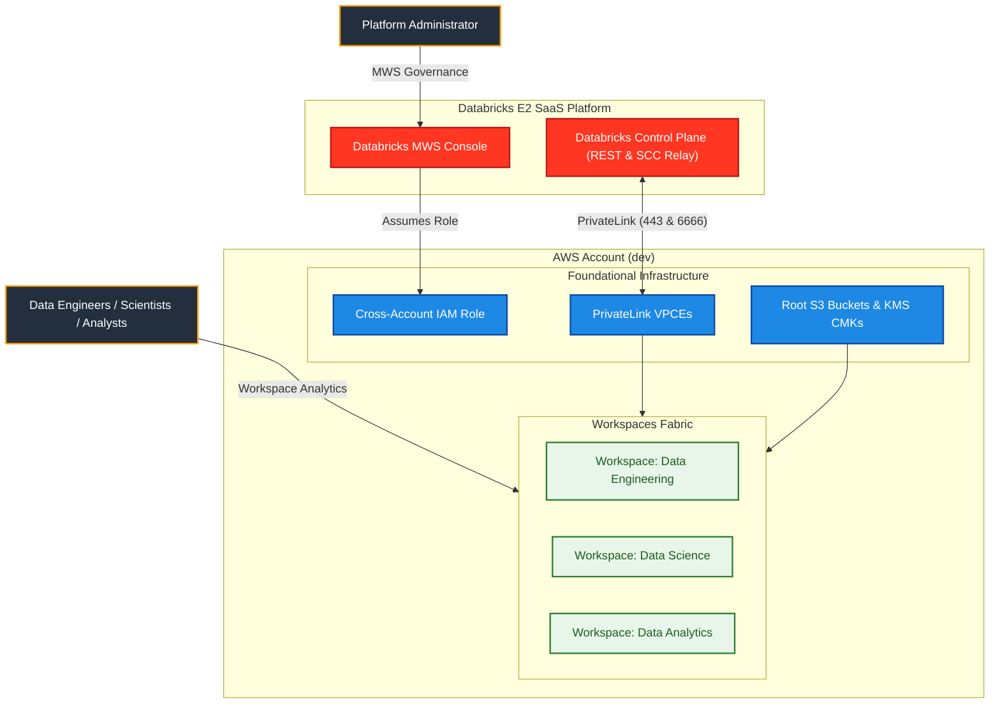
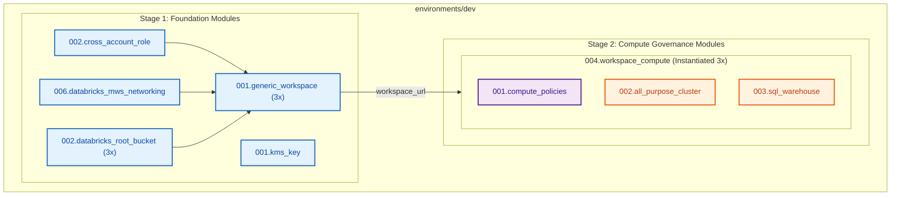

# Databricks Multi-Workspace and Compute Management - Dev Environment (`environments/dev`)

[](https://developer.hashicorp.com/terraform/docs)
[](https://registry.terraform.io/providers/hashicorp/aws/latest/docs)
[](https://registry.terraform.io/providers/databricks/databricks/latest/docs)
[](https://registry.terraform.io/providers/hashicorp/time/latest/docs)

---

## 1. Executive Summary

- **Purpose & Scope**:
  This environment orchestrates the complete end-to-end provisioning of dedicated Databricks workspaces and governed compute infrastructure for **Data Engineering**, **Data Science**, and **Data Analytics** personas in the `dev` environment. It builds on the networking foundation established in project `01_setup_vpc_networking` and the account identity governance established in project `02_setup_identity_management`.
- **Problem Statement & Solution**:
  Deploying multiple Databricks workspaces in an enterprise environment requires orchestrating account-level resources (cross-account IAM roles, PrivateLink endpoints, S3 root storage, KMS customer-managed keys) before workspace-level compute engines can be launched. This environment solves this dependency sequencing by separating deployment into an account-level foundation phase and a workspace-level compute governance phase.
- **Key Business & Security Outcomes**:
  - **AWS & Account Foundation**: Dedicated cross-account IAM role with AWS STS propagation protection, AWS PrivateLink interface endpoints for Workspace REST and SCC Relay traffic, and Databricks MWS network configuration.
  - **Isolated Storage**: Dedicated Amazon S3 root storage buckets per workspace, each encrypted with an independent customer-managed KMS key and registered with Databricks MWS.
  - **Multi-Workspace Fabric**: Discrete Databricks workspaces for `data_engineering`, `data_science`, and `data_analytics` personas with authoritative access assignments.
  - **Strict Compute Governance**: Enforced cluster policies—including a Platform Admin policy capped at **maximum 10 DBUs/hr**—ensuring no unconstrained clusters can be launched.
  - **Configured Workloads**: Automated autoscaling compute clusters and cost-optimized SQL Warehouses orchestrated via a single composite module instantiated per workspace.

---

## 2. General Logic & Operational Flow

### 2.1 Configuration & Dependency Lifecycle

```text
Project 01 (Spoke VPC, Subnets, SG)  ──>  AWS Data Lookups (data.tf)
Project 02 (Account Groups)          ──>  Databricks Data Lookups (data.tf)
                                                │
                                                ▼
         ┌──────────────────────────────────────────────────────────────┐
         │              Phase 1: Foundation (Account Plane)             │
         │  - S3 Backend & KMS Key                                      │
         │  - Cross-Account IAM Role (with 30s sleep)                   │
         │  - PrivateLink VPC Endpoints & MWS Network                   │
         │  - Dedicated Workspace KMS Keys & Root S3 Buckets            │
         │  - Generic MWS Workspaces & Group Role Assignments           │
         └──────────────────────────────┬───────────────────────────────┘
                                        │ (Workspace URLs Generated)
                                        ▼
         ┌──────────────────────────────────────────────────────────────┐
         │              Phase 2: Compute Governance (Workspace Plane)   │
         │  Composite Module: 004.workspace_compute (Instantiated 3x)   │
         │  - Compute Policies (Admin <=10 DBU, DE, DS, DA)             │
         │  - All-Purpose Compute Clusters (tied to policy IDs)         │
         │  - SQL Warehouses (with inactivity auto-stop)                │
         └──────────────────────────────────────────────────────────────┘
```

### 2.2 Network & Traffic Flow
- **Outbound Egress (Databricks Clusters -> SCC Relay)**:
  `[Databricks Compute Cluster]` $\rightarrow$ `[Private Subnet]` $\rightarrow$ `[AWS Interface VPCE: backend_relay]` $\rightarrow$ `[Databricks Control Plane (Port 6666)]`.
- **REST API Management**:
  `[Terraform / Developer]` $\rightarrow$ `[AWS Interface VPCE: backend_rest]` $\rightarrow$ `[Databricks Control Plane (Port 443)]`.
- **Data Storage**:
  `[Compute Clusters]` $\rightarrow$ `[AWS S3 Root Bucket]` $\rightarrow$ `[SSE-KMS Encryption]`.

---

## 3. Architecture of the Dev Environment

### 3.1 Network Topology & Integration
This environment imports existing network infrastructure provisioned by project `01_setup_vpc_networking`:

| Resource Type | Source | Purpose |
|:---|:---|:---|
| `vpc_id` | `data.aws_vpc.spoke` | Customer-managed Spoke VPC |
| `subnet_ids` | `data.aws_subnets.private_compute` | Private compute subnets across Availability Zones |
| `security_group_ids` | `data.aws_security_group.cluster_shared` | Databricks cluster inter-node security group |

### 3.2 Security, IAM & Encryption Posture
- **Encryption at Rest**:
  - Remote state bucket encrypted with dedicated KMS CMK (`alias/terraform-state-backend-03-dev`).
  - Each workspace has a dedicated KMS CMK (`alias/dbx-workspace-${workspace_name}-dev`) with automatic annual key rotation and root account delegation.
- **Cross-Account Access**:
  - Dedicated IAM role assumed by Databricks Account (`414351767826`) with conditional External ID verification matching the Databricks Account ID.
  - 30-second sleep buffer to prevent STS eventual consistency race conditions during MWS registration.

---

## 4. Architecture C4 Visualisations

### 4.1 Level 1: System Context Diagram



### 4.2 Level 2: Component Architecture Diagram



---

## 5. Provisioning Sequence & Staged Rollout

Because workspace-scoped providers require live workspace URLs determined during workspace creation, initial deployment follows a two-stage apply sequence:

### Stage 1: Foundation Deployment (Account Plane)
Provisions the state backend, cross-account credentials, PrivateLink networking, root storage, and creates the Databricks workspaces:

```bash
terraform init
terraform apply \
  -target="module.kms_key" \
  -target="module.backend_bucket" \
  -target="module.cross_account_role" \
  -target="module.mws_networking" \
  -target="module.workspace_kms_keys" \
  -target="module.root_buckets" \
  -target="module.workspaces"
```

### Stage 2: Compute & Policies Convergence (Workspace Plane)
Deploys the scoped cluster policies, compute clusters, SQL Warehouses, and object access control lists:

```bash
terraform apply
```

---

## 6. Compute Policy Governance Matrix

| Persona / Policy | Target Workspace | Core Constraints | Group Permissions |
|:---|:---|:---|:---|
| **Platform Admin** | All Workspaces | **Max 10 DBUs/hr cap**, max 4 workers, cost-efficient nodes (`m5.large`, `m5.xlarge`, `c5.xlarge`), max 45 min idle timeout | `CAN_USE` for `dbx-platform-admins` |
| **Data Engineering** | `data_engineering` | Auto-scaling 1–4 nodes, max 30 min idle timeout, ETL-ready compute | `CAN_USE` for `dbx-data-engineers` |
| **Data Science** | `data_science` | Single-user security mode, ML runtimes, GPU/CPU instances, max 20 min idle timeout | `CAN_USE` for `dbx-data-scientists` |
| **Data Analytics** | `data_analytics` | Single-node compute only (0 workers), max 15 min idle timeout | `CAN_USE` for `dbx-data-analysts` |

---

## 7. Module Inventory & References

- [`02.security/001.kms_key`](file:///modules/02.security/001.kms_key): Customer-managed KMS key for state and root storage encryption.
- [`02.security/002.cross_account_role`](file:///modules/02.security/002.cross_account_role): Databricks AWS cross-account role using official assume and cross-account policies with STS propagation protection.
- [`01.networking/006.databricks_mws_networking`](file:///modules/01.networking/006.databricks_mws_networking): AWS PrivateLink VPCEs, PAS, and Databricks network registration.
- [`03.storage/001.env_backend_bucket`](file:///modules/03.storage/001.env_backend_bucket): Secure S3 remote state storage bucket.
- [`03.storage/002.databricks_root_bucket`](file:///modules/03.storage/002.databricks_root_bucket): S3 root storage bucket using `databricks_aws_bucket_policy`, dynamic KMS grants, and MWS storage config.
- [`04.workspaces/001.generic_workspace`](file:///modules/04.workspaces/001.generic_workspace): Generic workspace creation and account group permission assignments.
- [`05.compute/001.compute_policies`](file:///modules/05.compute/001.compute_policies): Granular compute policies and policy ACLs.
- [`05.compute/002.all_purpose_cluster`](file:///modules/05.compute/002.all_purpose_cluster): Policy-enforced autoscaling clusters.
- [`05.compute/003.sql_warehouse`](file:///modules/05.compute/003.sql_warehouse): Auto-stopping BI SQL Warehouses.
- [`05.compute/004.workspace_compute`](file:///modules/05.compute/004.workspace_compute): Composite workspace compute module unifying policies, clusters, and warehouses into a single instantiation.
- [Terraform Documentation Interface (`TERRAFORM.md`)](./TERRAFORM.md): Machine-generated documentation of all inputs, outputs, and provider dependencies.
