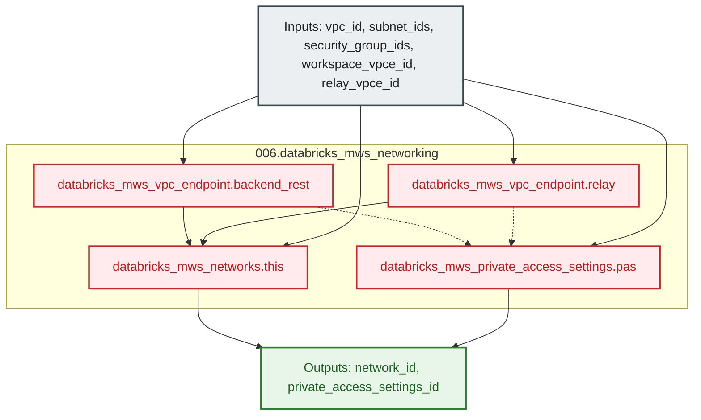

# Databricks MWS Customer-Managed VPC & PrivateLink Networking Module (`001.databricks_mws_networking`)

---

## 1. Executive Summary

- **Purpose & Scope**:
  This module registers a customer-managed AWS Spoke VPC, private compute subnets, cluster security groups, and AWS PrivateLink Control Plane VPC endpoints into the Databricks Multi-Workspace Service (MWS) Account console. It provisions the complete Databricks Account-level private connectivity stack (`databricks_mws_vpc_endpoint`, `databricks_mws_private_access_settings`, and `databricks_mws_networks`) required by Databricks E2 workspaces to establish private back-end connectivity between data plane clusters and control plane services.
- **Problem Statement & Solution**:
  By default, Databricks creates compute instances inside a Databricks-managed AWS VPC and communicates with the Control Plane over the public internet. For enterprise compliance, network routing, and security isolation, compute planes must execute inside a customer-managed VPC with private connectivity over AWS PrivateLink. This module encapsulates the registration of pre-provisioned AWS VPC networking and PrivateLink interface endpoints (created in project `01_setup_vpc_networking`) into Databricks Account MWS, exporting both `network_id` and `private_access_settings_id`.
- **Key Business & Security Outcomes**:
  - **Control Plane Private Connectivity**: Registers Workspace REST API and Secure Cluster Connectivity (SCC) Relay AWS VPC Endpoints with Databricks MWS and binds them to the customer-managed network configuration.
  - **Private Access Governance**: Configures Databricks Private Access Settings (PAS) governing public access policies and private access levels (`ACCOUNT` or `ENDPOINT`).
  - **Clean Architectural Boundary**: Separates the creation of physical AWS network and PrivateLink infrastructure (managed in upstream project `01_setup_vpc_networking`) from its registration in the Databricks account plane via AWS data source lookups.

---

## 2. General Logic & Operational Flow

### 2.1 Provisioning Lifecycle
1. **Network & Endpoint Parameter Ingestion**: Receives the AWS Spoke VPC ID, private compute subnet IDs, cluster security group IDs, and the AWS VPC Endpoint IDs (`workspace_vpce_id` and `relay_vpce_id`) resolved via `data` sources from project `01_setup_vpc_networking`.
2. **MWS VPC Endpoint Registration**: Registers the back-end Workspace REST API endpoint (`databricks_mws_vpc_endpoint.backend_rest`) and SCC Relay endpoint (`databricks_mws_vpc_endpoint.relay`) in the Databricks Account.
3. **Private Access Settings (PAS) Creation**: Provisions `databricks_mws_private_access_settings.pas` to enforce private connectivity rules for workspaces.
4. **MWS Network Registration**: Executes `databricks_mws_networks.this` binding the Spoke VPC, compute subnets, security groups, and the registered `rest_api` and `dataplane_relay` VPC endpoints.
5. **Identifier Export**: Exposes `network_id` and `private_access_settings_id` for consumption by workspace provisioning modules ([`001.generic_workspace`](file:///modules/04.workspaces/001.generic_workspace)).

### 2.2 Operational Context
- **Upstream Network Dependency**: The Spoke VPC, compute subnets, PrivateLink subnets (`spoke-pl-vpce-*`), security groups (`default_spoke_sg-*`, `spoke_pl_vpce_sg-*`), and AWS interface VPC endpoints (`databricks-workspace-vpce-*`, `databricks-scc-relay-vpce-*`) are provisioned by project `01_setup_vpc_networking` (`002.spoke_vpc` and `003.spoke_privatelink`) and retrieved dynamically via AWS data sources.
- **Downstream Workspace Attachment**: The resulting `network_id` and `private_access_settings_id` are supplied to `databricks_mws_workspaces` in [`001.generic_workspace`](file:///modules/04.workspaces/001.generic_workspace) during workspace creation.

---

## 3. Architecture of the Module

### 3.1 Resource Architecture & Attributes

| Resource Identifier | Resource Type | Description |
|:---|:---|:---|
| `databricks_mws_vpc_endpoint.backend_rest` | `databricks_mws_vpc_endpoint` | Registers the AWS Workspace (REST API) Interface VPC Endpoint in Databricks Account MWS |
| `databricks_mws_vpc_endpoint.relay` | `databricks_mws_vpc_endpoint` | Registers the AWS Secure Cluster Connectivity (SCC) Relay Interface VPC Endpoint in Databricks Account MWS |
| `databricks_mws_private_access_settings.pas` | `databricks_mws_private_access_settings` | Configures Private Access Settings (PAS) for Databricks workspaces |
| `databricks_mws_networks.this` | `databricks_mws_networks` | Registers customer-managed Spoke VPC, compute subnets, security groups, and PrivateLink VPC endpoints |

---

## 4. Architecture C4 Visualisation

### 4.1 Level 2: Component Architecture Diagram

---

## 5. All Modules Used with Short Summaries

This module does not invoke external submodules. It directly declares the `databricks_mws_vpc_endpoint`, `databricks_mws_private_access_settings`, and `databricks_mws_networks` resources using the account-level Databricks provider (`databricks.mws`).

- **Consumers**:
  - [`001.generic_workspace`](file:///modules/04.workspaces/001.generic_workspace) - Consumes `network_id` and `private_access_settings_id` to attach workspaces to the registered customer-managed network and PrivateLink configuration.
  - [`environments/dev`](file:///environments/dev) - Root environment orchestrator instantiating this module with AWS data source attributes from project `01_setup_vpc_networking`.

---

## 6. Terraform Documentation Interface

> [!NOTE]
> Machine-generated interface specifications for this module are maintained by `terraform-docs` in [`TERRAFORM.md`](./TERRAFORM.md).

### 6.1 Essential Inputs Summary

| Variable | Type | Description | Required |
|:---|:---:|:---|:---:|
| `databricks_account_id` | `string` | The Databricks Account ID used for MWS resources | Yes |
| `aws_region` | `string` | The AWS region where the Spoke VPC and PrivateLink VPC endpoints reside | Yes |
| `network_name` | `string` | The name of the Databricks MWS network configuration | Yes |
| `vpc_id` | `string` | The AWS VPC ID of the Spoke VPC | Yes |
| `subnet_ids` | `list(string)` | List of private compute subnet IDs within the Spoke VPC | Yes |
| `security_group_ids` | `list(string)` | List of security group IDs for Databricks compute clusters | Yes |
| `workspace_vpce_id` | `string` | The AWS VPC Endpoint ID (`vpce-*`) for the Databricks Workspace (REST API) PrivateLink endpoint | Yes |
| `relay_vpce_id` | `string` | The AWS VPC Endpoint ID (`vpce-*`) for the Databricks SCC Relay PrivateLink endpoint | Yes |
| `public_access_enabled` | `bool` | Whether public internet access to the workspace web console is allowed alongside PrivateLink | No |
| `private_access_level` | `string` | Private access level for Databricks Private Access Settings (`ACCOUNT` or `ENDPOINT`) | No |

### 6.2 Essential Outputs Summary

| Output | Type | Description |
|:---|:---:|:---|
| `network_id` | `string` | The unique identifier of the registered Databricks MWS network configuration |
| `private_access_settings_id` | `string` | The canonical unique identifier of the Databricks Private Access Settings (PAS) configuration |

---

## 7. Important Links and References

- [Databricks AWS PrivateLink Workspace Guide](https://registry.terraform.io/providers/databricks/databricks/latest/docs/guides/aws-private-link-workspace)
- [Databricks Classic Private Connectivity Documentation](https://docs.databricks.com/aws/en/security/network/classic/privatelink)
- [Databricks Customer-Managed VPC Guide](https://docs.databricks.com/aws/en/admin/cloud-configurations/aws/customer-managed-vpc)
- [Databricks MWS Networks Resource Documentation](https://registry.terraform.io/providers/databricks/databricks/latest/docs/resources/mws_networks)
- [Databricks MWS VPC Endpoint Resource Documentation](https://registry.terraform.io/providers/databricks/databricks/latest/docs/resources/mws_vpc_endpoint)
- [Databricks MWS Private Access Settings Resource Documentation](https://registry.terraform.io/providers/databricks/databricks/latest/docs/resources/mws_private_access_settings)
- [Terraform Documentation Interface (`TERRAFORM.md`)](./TERRAFORM.md)
