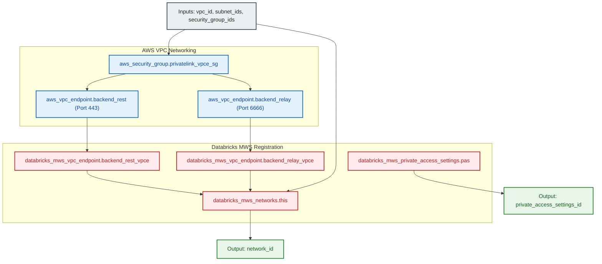

# Databricks MWS Networking & PrivateLink Connectivity Module (`006.databricks_mws_networking`)

---

## 1. Executive Summary

- **Purpose & Scope**:
  This module deploys and registers the AWS VPC Interface Endpoints (AWS PrivateLink) required for private, secure communication between Databricks compute clusters in a customer-managed VPC and the Databricks E2 control plane. It encapsulates AWS endpoint provisioning, security group controls, and Databricks Account console registrations (`databricks_mws_vpc_endpoint`, `databricks_mws_private_access_settings`, and `databricks_mws_networks`).
- **Problem Statement & Solution**:
  In an enterprise environment, routing control plane and Secure Cluster Connectivity (SCC) Relay traffic over the public internet exposes endpoints to external threats and violates compliance mandates. This module solves this by establishing dual AWS PrivateLink Interface VPC Endpoints inside private subnets, fronted by a dedicated security group, and registering them directly in Databricks Multi-Workspace Service (MWS).
- **Key Business & Security Outcomes**:
  - **Zero Public Ingress**: Compute clusters communicate with the Databricks control plane exclusively over private AWS network backbones.
  - **Fine-Grained Private Access Control**: Configurable Private Access Settings (PAS) defining whether workspace consoles are accessible publicly or restricted to PrivateLink endpoints.
  - **Reusable Network Abstraction**: Encapsulates VPC ID, subnets, cluster security groups, and endpoints into an immutable Databricks MWS network configuration.

---

## 2. General Logic & Operational Flow

### 2.1 Provisioning Lifecycle
1. **Endpoint Security Group**: Provisions `aws_security_group.privatelink_vpce_sg` allowing inbound HTTPS (`443`) and SCC Relay (`6666`) strictly from compute cluster security groups.
2. **Interface VPC Endpoints**: Creates two AWS Interface VPC Endpoints:
   - `aws_vpc_endpoint.backend_rest`: Connects compute planes to Databricks Workspace REST APIs.
   - `aws_vpc_endpoint.backend_relay`: Connects compute nodes to the Databricks Secure Cluster Connectivity (SCC) Relay service.
3. **MWS Endpoint Registration**: Registers both endpoints in Databricks MWS via `databricks_mws_vpc_endpoint` .
4. **Private Access Settings (PAS)**: Configures `databricks_mws_private_access_settings.pas` establishing access governance (`ACCOUNT` or `ENDPOINT` level).
5. **Network Registration**: Creates `databricks_mws_networks.this` binding the Spoke VPC, private compute subnets, cluster security groups, and registered PrivateLink endpoints into a single network configuration ID.

### 2.2 Network Traffic Flow
- **Workspace REST Operations**:
  `[Cluster / Client]` $\rightarrow$ `[aws_vpc_endpoint.backend_rest]` $\rightarrow$ `[AWS PrivateLink]` $\rightarrow$ `[Databricks Control Plane (Port 443)]`.
- **SCC Relay Communication**:
  `[Cluster Driver / Worker]` $\rightarrow$ `[aws_vpc_endpoint.backend_relay]` $\rightarrow$ `[AWS PrivateLink]` $\rightarrow$ `[Databricks SCC Relay (Port 6666)]`.

---

## 3. Architecture of the Module

### 3.1 Resource Architecture & Attributes

| Resource Identifier | Resource Type | Description |
|:---|:---|:---|
| `aws_security_group.privatelink_vpce_sg` | `aws_security_group` | Enforces ingress 443 and 6666 from cluster security groups |
| `aws_vpc_endpoint.backend_rest` | `aws_vpc_endpoint` | Interface endpoint for Workspace REST API |
| `aws_vpc_endpoint.backend_relay` | `aws_vpc_endpoint` | Interface endpoint for Secure Cluster Connectivity Relay |
| `databricks_mws_private_access_settings.pas` | `databricks_mws_private_access_settings` | Governs workspace private access levels and public access |
| `databricks_mws_vpc_endpoint.backend_rest_vpce` | `databricks_mws_vpc_endpoint` | MWS registered endpoint for REST API |
| `databricks_mws_vpc_endpoint.backend_relay_vpce` | `databricks_mws_vpc_endpoint` | MWS registered endpoint for SCC Relay |
| `databricks_mws_networks.this` | `databricks_mws_networks` | MWS network registration linking VPC, subnets, SG, and VPCEs |

---

## 4. Architecture C4 Visualisation

### 4.1 Level 2: Component Architecture Diagram

---

## 5. Terraform Documentation Interface

> [!NOTE]
> Machine-generated interface specifications for this module are maintained by `terraform-docs` in [`TERRAFORM.md`](./TERRAFORM.md).

### 5.1 Essential Inputs Summary

| Variable | Type | Description | Required |
|:---|:---:|:---|:---:|
| `databricks_account_id` | `string` | The Databricks Account ID | Yes |
| `network_name` | `string` | The name of the MWS network configuration | Yes |
| `vpc_id` | `string` | Spoke VPC ID hosting compute clusters | Yes |
| `subnet_ids` | `list(string)` | Private compute subnet IDs | Yes |
| `security_group_ids` | `list(string)` | Security group IDs attached to clusters | Yes |
| `aws_region` | `string` | AWS region | Yes |
| `workspace_vpce_service_name` | `string` | AWS PrivateLink service name for Workspace REST API | Yes |
| `relay_vpce_service_name` | `string` | AWS PrivateLink service name for SCC Relay | Yes |
| `public_access_enabled` | `bool` | Allow public browser access to workspace console (default: `true`) | No |
| `private_access_level` | `string` | Private access level (`ACCOUNT` or `ENDPOINT`, default: `\"ACCOUNT\"`) | No |

### 5.2 Essential Outputs Summary

| Output | Type | Description |
|:---|:---:|:---|
| `network_id` | `string` | The unique ID of the Databricks MWS network configuration |
| `private_access_settings_id` | `string` | The unique ID of the Databricks Private Access Settings |

---

## 6. Important Links and References

- [Databricks AWS PrivateLink Architecture](https://docs.databricks.com/aws/en/security/network/classic/privatelink)
- [Databricks MWS Networks Resource Documentation](https://registry.terraform.io/providers/databricks/databricks/latest/docs/resources/mws_networks)
- [Databricks Private Access Settings Documentation](https://registry.terraform.io/providers/databricks/databricks/latest/docs/resources/mws_private_access_settings)
- [Terraform Documentation Interface (`TERRAFORM.md`)](./TERRAFORM.md)
