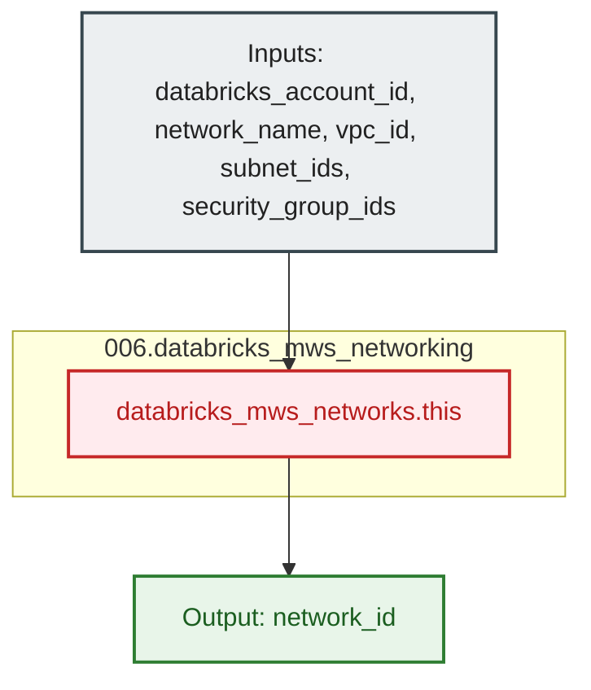

# Databricks MWS Customer-Managed VPC Networking Module (`006.databricks_mws_networking`)

---

## 1. Executive Summary

- **Purpose & Scope**:
  This module registers a customer-managed AWS Spoke VPC, private compute subnets, and cluster security groups into the Databricks Multi-Workspace Service (MWS) Account console via `databricks_mws_networks`. It provides the foundational network configuration ID required by Databricks E2 workspaces to deploy serverless and classic compute planes within a dedicated AWS VPC perimeter.
- **Problem Statement & Solution**:
  By default, Databricks creates compute instances inside a Databricks-managed AWS VPC. For enterprise compliance, network routing, and security isolation, compute planes must execute inside a customer-managed VPC with defined private subnets and restrictive security groups. This module encapsulates the registration of the customer-managed AWS networking infrastructure into Databricks Account MWS, validating subnet requirements and exporting an immutable `network_id`.
- **Key Business & Security Outcomes**:
  - **Network Perimeter Isolation**: Ensures compute clusters are launched inside pre-configured private subnets with strict security group egress and ingress controls.
  - **Account-Level Decoupling**: Registers networking at the Databricks MWS account plane, allowing reuse across multiple persona-dedicated workspaces.
  - **Clean Architectural Boundary**: Separates the creation of AWS network infrastructure (managed in upstream networking projects) from its registration in the Databricks account plane.

---

## 2. General Logic & Operational Flow

### 2.1 Provisioning Lifecycle
1. **Network Parameter Ingestion**: Receives the AWS Spoke VPC ID, private compute subnet IDs across Availability Zones, and cluster security group IDs.
2. **MWS Network Registration**: Executes `databricks_mws_networks.this` against the Databricks Account console using the `databricks.mws` provider alias.
3. **Network Identifier Export**: Exposes `network_id` for consumption by workspace provisioning modules ([`001.generic_workspace`](file:///modules/04.workspaces/001.generic_workspace)).

### 2.2 Operational Context
- **Upstream Network Dependency**: The Spoke VPC, subnets, and security groups are provisioned by project `01_setup_vpc_networking` and retrieved dynamically via AWS data sources.
- **Downstream Workspace Attachment**: The resulting `network_id` is supplied to `databricks_mws_workspaces` in [`001.generic_workspace`](file:///modules/04.workspaces/001.generic_workspace) during workspace creation.

---

## 3. Architecture of the Module

### 3.1 Resource Architecture & Attributes

| Resource Identifier | Resource Type | Description |
|:---|:---|:---|
| `databricks_mws_networks.this` | `databricks_mws_networks` | Databricks MWS network configuration registering customer-managed VPC, subnets, and security groups |

---

## 4. Architecture C4 Visualisation

### 4.1 Level 2: Component Architecture Diagram

---

## 5. All Modules Used with Short Summaries

This module does not invoke external submodules. It directly declares the `databricks_mws_networks` resource using the account-level Databricks provider (`databricks.mws`).

- **Consumers**:
  - [`001.generic_workspace`](file:///modules/04.workspaces/001.generic_workspace) - Consumes `network_id` to attach workspaces to the registered customer-managed network.
  - [`environments/dev`](file:///environments/dev) - Root environment orchestrator instantiating this module.

---

## 6. Terraform Documentation Interface

> [!NOTE]
> Machine-generated interface specifications for this module are maintained by `terraform-docs` in [`TERRAFORM.md`](./TERRAFORM.md).

### 6.1 Essential Inputs Summary

| Variable | Type | Description | Required |
|:---|:---:|:---|:---:|
| `databricks_account_id` | `string` | The Databricks Account ID used for MWS resources | Yes |
| `network_name` | `string` | The name of the Databricks MWS network configuration | Yes |
| `vpc_id` | `string` | The AWS VPC ID of the Spoke VPC | Yes |
| `subnet_ids` | `list(string)` | List of private compute subnet IDs within the Spoke VPC | Yes |
| `security_group_ids` | `list(string)` | List of security group IDs for Databricks compute clusters | Yes |

### 6.2 Essential Outputs Summary

| Output | Type | Description |
|:---|:---:|:---|
| `network_id` | `string` | The unique identifier of the registered Databricks MWS network configuration |

---

## 7. Important Links and References

- [Databricks Customer-Managed VPC Guide](https://docs.databricks.com/aws/en/admin/cloud-configurations/aws/customer-managed-vpc)
- [Databricks MWS Networks Resource Documentation](https://registry.terraform.io/providers/databricks/databricks/latest/docs/resources/mws_networks)
- [Terraform Documentation Interface (`TERRAFORM.md`)](./TERRAFORM.md)
