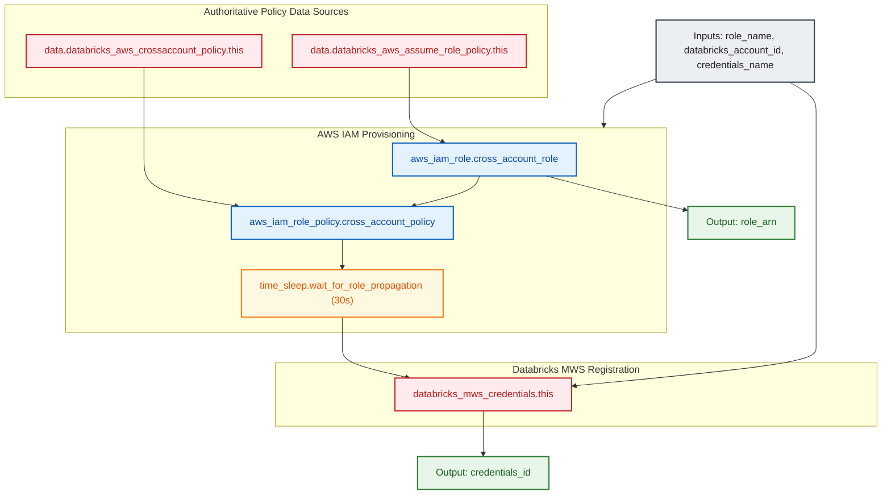

# Databricks Cross-Account IAM Role & MWS Credentials Module (`002.cross_account_role`)

---

## 1. Executive Summary

- **Purpose & Scope**:
  This module provisions the AWS IAM cross-account role required by Databricks E2 architecture to launch and manage cluster compute resources within a customer-managed AWS VPC. It automatically registers the role in the Databricks Account console (`databricks_mws_credentials`) and safeguards against AWS STS eventual consistency propagation delays using a managed 30-second sleep.
- **Problem Statement & Solution**:
  When a cross-account role is newly created in AWS IAM, global STS endpoint propagation takes several seconds. Attempting immediate registration in Databricks MWS causes sporadic `Role cannot be assumed` or `Invalid credentials` errors. This module eliminates race conditions by generating policies via official Databricks data sources, applying a guaranteed 30-second `time_sleep`, and then registering the role with MWS.
- **Key Business & Security Outcomes**:
  - **Zero Trust Role Delegation**: The trust policy specifies Databricks AWS Account (`414351767826`) and enforces conditional External ID validation matching the customer's Databricks Account ID.
  - **Authoritative Databricks Policies**: Uses official provider data sources (`databricks_aws_assume_role_policy` and `databricks_aws_crossaccount_policy`), preventing outdated or permissive policy drift.
  - **Deterministic Deployment**: `time_sleep` prevents CI/CD pipeline failures caused by AWS STS eventual consistency delays.

---

## 2. General Logic & Operational Flow

### 2.1 Provisioning Lifecycle
1. **Trust Policy Generation**: Queries `data.databricks_aws_assume_role_policy.this` with `external_id = var.databricks_account_id`.
2. **Permissions Policy Generation**: Queries `data.databricks_aws_crossaccount_policy.this` (`policy_type = "customer"`).
3. **IAM Role Creation**: Instantiates `aws_iam_role.cross_account_role` attaching the assume role trust policy.
4. **Policy Attachment**: Creates `aws_iam_role_policy.cross_account_policy` granting cross-account permissions.
5. **Propagation Sleep**: Executes `time_sleep.wait_for_role_propagation` (30 seconds) ensuring the newly created IAM role is globally assumed by AWS STS endpoints.
6. **MWS Credentials Registration**: Registers `databricks_mws_credentials.this` in the Databricks Account console, outputting `credentials_id`.

---

## 3. Architecture of the Module

### 3.1 Resource Architecture & Attributes

| Resource Identifier | Resource Type | Description |
|:---|:---|:---|
| `data.databricks_aws_assume_role_policy.this` | `data source` | Canonical Databricks STS assume role trust policy with External ID |
| `data.databricks_aws_crossaccount_policy.this` | `data source` | Canonical Databricks cross-account IAM permissions |
| `aws_iam_role.cross_account_role` | `aws_iam_role` | AWS IAM role assumed by Databricks control plane |
| `aws_iam_role_policy.cross_account_policy` | `aws_iam_role_policy` | Inline policy attaching cross-account permissions to the role |
| `time_sleep.wait_for_role_propagation` | `time_sleep` | 30-second delay mitigating AWS STS eventual consistency |
| `databricks_mws_credentials.this` | `databricks_mws_credentials` | Databricks MWS credential object linking IAM Role ARN |

---

## 4. Architecture C4 Visualisation

### 4.1 Level 2: Component Architecture Diagram

---

## 5. All Modules Used with Short Summaries

This module does not invoke external submodules. It provisions native AWS IAM and Time resources directly and registers credentials in Databricks MWS using `databricks.mws`.

- **Consumers**:
  - [`001.generic_workspace`](file:///modules/04.workspaces/001.generic_workspace) - Consumes `credentials_id` to link cross-account IAM credentials to workspaces.
  - [`002.databricks_root_bucket`](file:///modules/03.storage/002.databricks_root_bucket) - Consumes `role_arn` to establish KMS decryption grants for worker nodes.
  - [`environments/dev`](file:///environments/dev) - Root environment orchestrator instantiating this cross-account role module.

---

## 6. Terraform Documentation Interface

> [!NOTE]
> Machine-generated interface specifications for this module are maintained by `terraform-docs` in [`TERRAFORM.md`](./TERRAFORM.md).

### 6.1 Essential Inputs Summary

| Variable | Type | Description | Required |
|:---|:---:|:---|:---:|
| `role_name` | `string` | The name of the AWS IAM cross-account role | Yes |
| `databricks_account_id` | `string` | The Databricks Account ID used as External ID | Yes |
| `credentials_name` | `string` | The name of the Databricks MWS credentials configuration | Yes |
| `tags` | `map(string)` | Map of resource tags to attach to the IAM role | No |

### 6.2 Essential Outputs Summary

| Output | Type | Description |
|:---|:---:|:---|
| `credentials_id` | `string` | The unique identifier of the registered Databricks MWS credentials |
| `role_arn` | `string` | The Amazon Resource Name (ARN) of the created IAM role |

---

## 7. Important Links and References

- [Databricks Cross-Account IAM Role Documentation](https://docs.databricks.com/aws/en/security/iam/credentials)
- [Databricks MWS Credentials Resource Documentation](https://registry.terraform.io/providers/databricks/databricks/latest/docs/resources/mws_credentials)
- [Terraform Documentation Interface (`TERRAFORM.md`)](./TERRAFORM.md)
