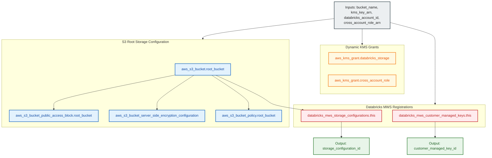

# Databricks S3 Root Storage Bucket & MWS Storage Module (`002.databricks_root_bucket`)

---

## 1. Executive Summary

- **Purpose & Scope**:
  This module provisions a hardened Amazon S3 root storage bucket for an individual Databricks workspace following AWS and Databricks architecture best practices. It configures Customer-Managed Key (KMS) encryption (SSE-KMS), strict public access blocking, bucket ownership enforcement, canonical Databricks bucket policies, and dynamic KMS grants. It simultaneously registers both the KMS key (`databricks_mws_customer_managed_keys`) and the root storage bucket (`databricks_mws_storage_configurations`) in the Databricks Account console.
- **Problem Statement & Solution**:
  Databricks workspace creation requires dedicated S3 root storage for workspace system data (DBFS, cluster logs, notebook revisions, job results). Hardcoding policy JSONs or AWS account IDs introduces security drift, while manual console registration breaks IaC automation. This module eliminates manual steps by generating policies via `databricks_aws_bucket_policy`, establishing dynamic KMS grants for the Databricks control plane and cross-account IAM role, and registering storage objects directly in Databricks MWS.
- **Key Business & Security Outcomes**:
  - **Envelope Encryption with S3 Bucket Keys**: Protects root storage with dedicated KMS CMKs while reducing KMS API request costs by up to 99% using S3 Bucket Keys.
  - **Zero Public Access**: Enforces `BucketOwnerEnforced` (disabling ACLs) and enables all four S3 Public Access Block settings.
  - **Dynamic Cryptographic Delegation**: Automatically decodes Databricks STS assume role policies to create fine-grained `aws_kms_grant` resources without hardcoding Databricks AWS account numbers.

---

## 2. General Logic & Operational Flow

### 2.1 Provisioning Lifecycle
1. **S3 Root Storage**: Instantiates `aws_s3_bucket.root_bucket` with configurable `force_destroy`.
2. **Access Control & Hardening**:
   - Applies `aws_s3_bucket_ownership_controls` enforcing `BucketOwnerEnforced`.
   - Applies `aws_s3_bucket_public_access_block` blocking all public ACLs and policies.
   - Configures `aws_s3_bucket_lifecycle_configuration` to abort incomplete multipart uploads after 7 days.
3. **SSE-KMS Encryption**: Configures `aws_s3_bucket_server_side_encryption_configuration` with the CMK ARN and `bucket_key_enabled = true`.
4. **Bucket Policy Attachment**: Queries `data.databricks_aws_bucket_policy.this` and attaches `aws_s3_bucket_policy.root_bucket`.
5. **Dynamic KMS Grants**: Decodes Databricks principal ARN from `data.databricks_aws_assume_role_policy.kms_trust` and provisions:
   - `aws_kms_grant.databricks_storage` (for Databricks E2 control plane).
   - `aws_kms_grant.cross_account_role` (for compute cluster worker nodes).
6. **MWS Registrations**:
   - Registers the CMK in MWS via `databricks_mws_customer_managed_keys.this` (`use_cases = ["STORAGE"]`).
   - Registers the S3 bucket in MWS via `databricks_mws_storage_configurations.this`.

---

## 3. Architecture of the Module

### 3.1 Resource Architecture & Attributes

| Resource Identifier | Resource Type | Description |
|:---|:---|:---|
| `aws_s3_bucket.root_bucket` | `aws_s3_bucket` | Dedicated S3 root bucket for DBFS and workspace system data |
| `aws_s3_bucket_ownership_controls.root_bucket` | `aws_s3_bucket_ownership_controls` | Enforces modern BucketOwnerEnforced ownership model |
| `aws_s3_bucket_public_access_block.root_bucket` | `aws_s3_bucket_public_access_block` | Strict 4-point public access blocking |
| `aws_s3_bucket_server_side_encryption_configuration.root_bucket` | `aws_s3_bucket_server_side_encryption_configuration` | SSE-KMS encryption with S3 Bucket Keys |
| `aws_s3_bucket_lifecycle_configuration.root_bucket` | `aws_s3_bucket_lifecycle_configuration` | Aborts incomplete multipart uploads after 7 days |
| `aws_s3_bucket_policy.root_bucket` | `aws_s3_bucket_policy` | Databricks canonical root bucket policy |
| `aws_kms_grant.databricks_storage` | `aws_kms_grant` | Decryption/encryption grant for Databricks storage service |
| `aws_kms_grant.cross_account_role` | `aws_kms_grant` | Decryption/encryption grant for compute cross-account role |
| `databricks_mws_customer_managed_keys.this` | `databricks_mws_customer_managed_keys` | MWS customer-managed key registration for storage |
| `databricks_mws_storage_configurations.this` | `databricks_mws_storage_configurations` | MWS root storage registration linking bucket name |

---

## 4. Architecture C4 Visualisation

### 4.1 Level 2: Component Architecture Diagram

---

## 5. Terraform Documentation Interface

> [!NOTE]
> Machine-generated interface specifications for this module are maintained by `terraform-docs` in [`TERRAFORM.md`](./TERRAFORM.md).

### 5.1 Essential Inputs Summary

| Variable | Type | Description | Required |
|:---|:---:|:---|:---:|
| `bucket_name` | `string` | Unique Amazon S3 root storage bucket name | Yes |
| `kms_key_arn` | `string` | ARN of the KMS customer-managed key for bucket encryption | Yes |
| `databricks_account_id` | `string` | The Databricks Account ID | Yes |
| `storage_configuration_name` | `string` | Name of the MWS storage configuration | Yes |
| `cross_account_role_arn` | `string` | ARN of the cross-account IAM role | Yes |
| `force_destroy` | `bool` | Allow force destroying bucket objects on delete (default: `false`) | No |

### 5.2 Essential Outputs Summary

| Output | Type | Description |
|:---|:---:|:---|
| `storage_configuration_id` | `string` | The unique ID of the Databricks MWS storage configuration |
| `customer_managed_key_id` | `string` | The Databricks MWS customer-managed key ID |

---

## 6. Important Links and References

- [Databricks S3 Storage Requirements](https://docs.databricks.com/aws/en/administration-guide/account-settings-e2/storage)
- [Databricks Customer-Managed Keys for Storage](https://docs.databricks.com/aws/en/security/keys/customer-managed-keys-storage-aws)
- [Databricks MWS Storage Configurations Resource Documentation](https://registry.terraform.io/providers/databricks/databricks/latest/docs/resources/mws_storage_configurations)
- [Terraform Documentation Interface (`TERRAFORM.md`)](./TERRAFORM.md)
