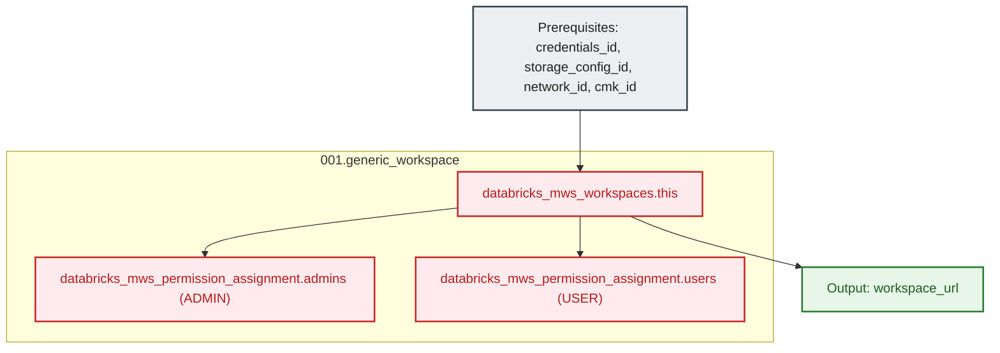

# Generic Databricks Workspace & Group Assignment Module (`001.generic_workspace`)

---

## 1. Executive Summary

- **Purpose & Scope**:
  This module provisions a foundational Databricks workspace on AWS via Databricks Multi-Workspace Service (`databricks_mws_workspaces`). It strictly encapsulates workspace infrastructure—cross-account IAM credentials, root S3 storage configuration, customer-managed VPC networking, and customer-managed storage KMS key—without coupling compute or cluster resources. It also manages account-level workspace permission assignments (`databricks_mws_permission_assignment`) granting `ADMIN` access to platform administrators and `USER` access to authorized user groups.
- **Problem Statement & Solution**:
  Coupling workspace provisioning directly with clusters, notebooks, or compute policies creates circular dependencies and deployment failures because the workspace API cannot accept compute requests until the workspace URL is fully provisioned and responsive. This module enforces a clean infrastructure boundary by handling only workspace registration and access assignments, cleanly outputting the `workspace_url` for downstream compute orchestrators.
- **Key Business & Security Outcomes**:
  - **Modular Decoupling**: Pure infrastructure abstraction separating account-level workspace lifecycle from workspace-level compute resources.
  - **RBAC Governance**: Automatically grants authoritative `ADMIN` role to platform administrators and `USER` role to designated persona user groups.
  - **Encryption & VPC Binding**: Binds customer-managed VPC and dedicated customer-managed storage KMS keys at the workspace level.

---

## 2. General Logic & Operational Flow

### 2.1 Provisioning Lifecycle
1. **Workspace Instantiation**: Calls `databricks_mws_workspaces.this` binding all prerequisite configuration IDs:
   - `credentials_id`: Cross-account IAM role registered in MWS.
   - `storage_configuration_id`: S3 root storage bucket registered in MWS.
   - `network_id`: Customer-managed VPC registered in MWS.
   - `storage_customer_managed_key_id`: CMK registered in MWS for root storage encryption.
   - `private_access_settings_id`: Private Access Settings (PAS) registered in MWS for AWS PrivateLink connectivity.
2. **Platform Admin Assignment**: Executes `databricks_mws_permission_assignment.admins` granting the `ADMIN` role to `var.admin_group_name`.
3. **User Group Assignment**: Executes `databricks_mws_permission_assignment.users` granting the `USER` role to `var.user_group_names`.
4. **Outputs**: Exposes `workspace_url` for downstream compute orchestrators.

---

## 3. Architecture of the Module

### 3.1 Resource Architecture & Attributes

| Resource Identifier | Resource Type | Description |
|:---|:---|:---|
| `databricks_mws_workspaces.this` | `databricks_mws_workspaces` | Databricks E2 workspace linking credentials, storage, network, and KMS |
| `databricks_mws_permission_assignment.admins` | `databricks_mws_permission_assignment` | Grants `ADMIN` permissions to the platform administrator group |
| `databricks_mws_permission_assignment.users` | `databricks_mws_permission_assignment` | Grants `USER` permissions to authorized user groups |

---

## 4. Architecture C4 Visualisation

### 4.1 Level 2: Component Architecture Diagram

---

## 5. All Modules Used with Short Summaries

This module does not invoke external submodules. It provisions Databricks MWS workspaces and account permission assignments directly using the account-level provider (`databricks.mws`).

- **Consumers**:
  - [`004.workspace_compute`](file:///modules/05.compute/004.workspace_compute) - Uses `workspace_url` to target workspace-scoped provider operations for compute clusters, SQL Warehouses, and policies.
  - [`environments/dev`](file:///environments/dev) - Root environment orchestrator instantiating this module per persona workspace.

---

## 6. Terraform Documentation Interface

> [!NOTE]
> Machine-generated interface specifications for this module are maintained by `terraform-docs` in [`TERRAFORM.md`](./TERRAFORM.md).

### 6.1 Essential Inputs Summary

| Variable | Type | Description | Required |
|:---|:---:|:---|:---:|
| `account_id` | `string` | The Databricks Account ID | Yes |
| `aws_region` | `string` | AWS region where the workspace is provisioned | Yes |
| `workspace_name` | `string` | Name of the Databricks workspace | Yes |
| `credentials_id` | `string` | Registered MWS credentials ID | Yes |
| `storage_configuration_id` | `string` | Registered MWS storage configuration ID | Yes |
| `network_id` | `string` | Registered MWS network ID | Yes |
| `storage_customer_managed_key_id` | `string` | Registered MWS CMK ID for storage encryption | Yes |
| `private_access_settings_id` | `string` | Registered MWS Private Access Settings (PAS) ID for PrivateLink connectivity | No |
| `admin_group_name` | `string` | Platform administrator group name | No |
| `user_group_names` | `list(string)` | List of user group names granted USER access | No |
| `pricing_tier` | `string` | Pricing tier (`PREMIUM` or `ENTERPRISE`, default: `\"ENTERPRISE\"`) | No |

### 6.2 Essential Outputs Summary

| Output | Type | Description |
|:---|:---:|:---|
| `workspace_url` | `string` | Full HTTPS URL of the workspace (e.g. `https://dbc-xxxx.cloud.databricks.com`) |

---

## 7. Important Links and References

- [Databricks Workspaces Resource Documentation](https://registry.terraform.io/providers/databricks/databricks/latest/docs/resources/mws_workspaces)
- [Databricks Permission Assignment Resource Documentation](https://registry.terraform.io/providers/databricks/databricks/latest/docs/resources/mws_permission_assignment)
- [Terraform Documentation Interface (`TERRAFORM.md`)](./TERRAFORM.md)
