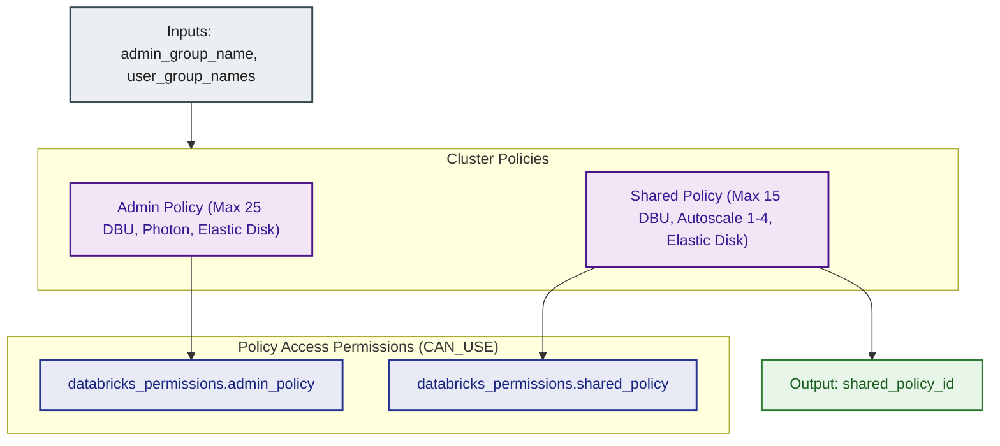

# Databricks Compute Cluster Policies Module (`001.compute_policies`)

---

## 1. Executive Summary

- **Purpose & Scope**:
  This module provisions role-based Databricks Cluster Policies (`databricks_cluster_policy`) and binds granular access permissions (`databricks_permissions`) granting `CAN_USE` to authorized groups. It enforces strict architectural and financial constraints across all compute workloads, featuring a hard **25 DBU/hour budget cap** on platform administrator compute, alongside a governed **Shared Workspace Policy** capped at **15 DBU/hour** for workspace users.
- **Problem Statement & Solution**:
  Without cluster policies, users can launch oversized instances (such as GPU nodes for basic queries), omit auto-termination timeouts, run out of disk space during heavy shuffles, or exceed enterprise infrastructure budgets. This module prevents compute sprawl and job failures by enforcing JSON policy definitions that restrict allowable instance types, mandate autoscaling local storage (`enable_elastic_disk = true`), enforce mandatory autotermination, cap worker autoscaling limits, restrict runtime engines, constrain Databricks runtime versions to latest releases, and restrict cluster creation permissions.
- **Key Business & Security Outcomes**:
  - **Financial Guardrails**: A hard limit of 25 DBUs/hour on Platform Admin clusters and 15 DBUs/hour on Shared Workspace clusters prevents accidental high-cost compute operations.
  - **Engine & Architecture Optimization**: Platform Admins and shared users are permitted to use the vectorized Photon runtime engine, strictly paired with Photon-compatible EC2 node families (`.xlarge` and `.2xlarge` tiers in `m5`, `m6i`, `c5`, `c6i`, `r5`, `r6i`, `i3`, `i4i`). Sub-xlarge instances (`.large`) are removed from Photon-capable policies to avoid runtime failures.
  - **Autoscaling Storage (Elastic Disk)**: Enforces `enable_elastic_disk = true` across policies to dynamically attach additional EBS volumes during large shuffle or data spill operations.
  - **Runtime Version Governance**: Only the latest and previous GA and LTS Databricks Runtime releases (`auto:latest`, `auto:prev-major`, `auto:latest-lts`, `auto:prev-lts`) are permitted.
  - **Role-Based Access Control**: Binds `CAN_USE` permissions to specific user groups and administrators, ensuring users only launch approved cluster configurations.

---

## 2. General Logic & Operational Flow

### 2.1 Governance Matrix & Constraints

| Policy Name | Target Group | Node Type Allowlist | Worker Limits | Max Inactivity Timeout | Photon Support | Autoscaling Storage | DBU / Budget Constraints |
|:---|:---|:---|:---:|:---:|:---:|:---:|:---|
| **Platform Admin** | `admin_group_name` | `m5.xlarge`, `m5.2xlarge`, `m6i.xlarge`, `m6i.2xlarge`, `c5.xlarge`, `c5.2xlarge`, `c6i.xlarge`, `c6i.2xlarge`, `r5.xlarge`, `r5.2xlarge`, `r6i.xlarge`, `r6i.2xlarge`, `i3.xlarge`, `i3.2xlarge`, `i4i.xlarge`, `i4i.2xlarge` | Max 4 workers | 45 minutes | Allowed (`PHOTON` / `STANDARD`) | Enforced (`enable_elastic_disk = true`) | **Max 25 DBUs/hr** (`dbus_per_hour` range cap) |
| **Shared Workspace** | `user_group_names` | `m5.xlarge`, `m5.2xlarge`, `m6i.xlarge`, `m6i.2xlarge`, `c5.xlarge`, `c5.2xlarge`, `c6i.xlarge`, `c6i.2xlarge`, `r5.xlarge`, `r5.2xlarge`, `r6i.xlarge`, `r6i.2xlarge`, `i3.xlarge`, `i3.2xlarge`, `i4i.xlarge`, `i4i.2xlarge` | Autoscale 1–4 workers | 30 minutes | Allowed (`PHOTON` / `STANDARD`) | Enforced (`enable_elastic_disk = true`) | **Max 15 DBUs/hr** (`dbus_per_hour` range cap) |

### 2.2 Provisioning Lifecycle
1. **Admin Policy Creation**: Provisions `databricks_cluster_policy.admin_policy` with the 25 DBU cap, Photon support, elastic disk enforcement, and assigns `CAN_USE` to `var.admin_group_name`.
2. **Shared Workspace Policy**: Provisions `databricks_cluster_policy.shared_policy` with the 15 DBU cap, Photon support, elastic disk enforcement, and assigns `CAN_USE` to `var.admin_group_name` and `var.user_group_names`.
3. **Policy ID Export**: Exposes `shared_policy_id` for downstream cluster binding.

---

## 3. Architecture of the Module

### 3.1 Resource Architecture & Attributes

| Resource Identifier | Resource Type | Description |
|:---|:---|:---|
| `databricks_cluster_policy.admin_policy` | `databricks_cluster_policy` | Capped policy enforcing max 25 DBUs/hr budget cap, Photon support, and elastic disk |
| `databricks_permissions.admin_policy` | `databricks_permissions` | Grants `CAN_USE` to the platform admin group |
| `databricks_cluster_policy.shared_policy` | `databricks_cluster_policy` | Workspace shared policy enforcing max 15 DBUs/hr budget cap and elastic disk |
| `databricks_permissions.shared_policy` | `databricks_permissions` | Grants `CAN_USE` to admins and user groups |

---

## 4. Architecture C4 Visualisation

### 4.1 Level 2: Component Architecture Diagram

---

## 5. Terraform Documentation Interface

> [!NOTE]
> Machine-generated interface specifications for this module are maintained by `terraform-docs` in [`TERRAFORM.md`](./TERRAFORM.md).

### 5.1 Essential Inputs Summary

| Variable | Type | Description | Required |
|:---|:---:|:---|:---:|
| `admin_group_name` | `string` | Name of the platform admin group granted policy access | Yes |
| `user_group_names` | `list(string)` | List of user group names granted CAN_USE permission | No |

### 5.2 Essential Outputs Summary

| Output | Type | Description |
|:---|:---:|:---|
| `shared_policy_id` | `string` | The shared cluster policy ID governing workspace compute clusters |

---

## 6. Important Links and References

- [Databricks Cluster Policy Reference](https://docs.databricks.com/aws/en/admin/clusters/policies)
- [Databricks Cluster Policy Resource Documentation](https://registry.terraform.io/providers/databricks/databricks/latest/docs/resources/cluster_policy)
- [Databricks Permissions Resource Documentation](https://registry.terraform.io/providers/databricks/databricks/latest/docs/resources/permissions)
- [Terraform Documentation Interface (`TERRAFORM.md`)](./TERRAFORM.md)
