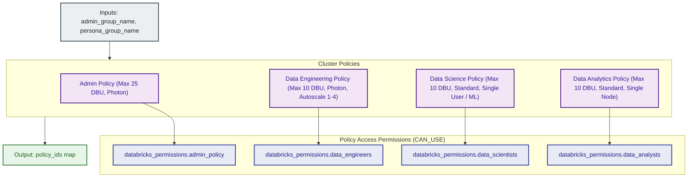

# Databricks Compute Cluster Policies Module (`001.compute_policies`)

---

## 1. Executive Summary

- **Purpose & Scope**:
  This module provisions role-based Databricks Cluster Policies (`databricks_cluster_policy`) and binds granular access permissions (`databricks_permissions`) granting `CAN_USE` to authorized groups. It enforces strict architectural and financial constraints across all compute workloads, featuring a hard **25 DBU/hour budget cap** on platform administrator compute, alongside persona policies for Data Engineering, Data Science, and Data Analytics capped at **10 DBU/hour**.
- **Problem Statement & Solution**:
  Without cluster policies, users can launch oversized instances (such as GPU nodes for basic SQL queries), omit auto-termination timeouts, or exceed enterprise infrastructure budgets. This module prevents compute sprawl by enforcing JSON policy definitions that restrict allowable instance types, enforce mandatory autotermination, cap worker autoscaling limits, restrict runtime engines (Photon enablement only for admins and data engineers), constrain Databricks runtime versions to latest and previous releases, and restrict cluster creation permissions.
- **Key Business & Security Outcomes**:
  - **Financial Guardrails**: A hard limit of 25 DBUs/hour on Platform Admin clusters and 10 DBUs/hour across all other persona groups prevents accidental high-cost compute operations.
  - **Engine & Architecture Optimization**: Only Platform Admins and Data Engineers are permitted to use the vectorized Photon runtime engine, paired with Photon-capable node families (general purpose, compute-optimized, memory-optimized, storage-optimized). Data Science and Data Analytics are strictly pinned to the standard engine.
  - **Runtime Version Governance**: Only the latest and previous GA and LTS Databricks Runtime releases (`auto:latest`, `auto:prev-major`, `auto:latest-lts`, `auto:prev-lts`, and ML equivalents) are permitted across all policies.
  - **Persona Tailoring**: Specialized policies tailored to ETL pipelines (autoscale 1–4, Photon-capable), Machine Learning (single-user security mode, GPU/CPU allowlist), and Ad-hoc Analytics (strictly single-node, directing heavy BI to SQL Warehouses).
  - **Role-Based Access Control**: Binds `CAN_USE` permissions to specific persona groups and administrators, ensuring users only launch approved cluster configurations.

---

## 2. General Logic & Operational Flow

### 2.1 Governance Matrix & Constraints

| Policy Name | Target Group | Node Type Allowlist | Worker Limits | Max Inactivity Timeout | Photon Support | Runtime Restrictions | DBU / Budget Constraints |
|:---|:---|:---|:---:|:---:|:---:|:---|:---|
| **Platform Admin** | `admin_group_name` | `m5.large`, `m5.xlarge`, `m5.2xlarge`, `c5.xlarge`, `c5.2xlarge`, `r5.xlarge`, `r5.2xlarge` | Max 4 workers | 45 minutes | Allowed (`PHOTON` / `STANDARD`) | `auto:latest-lts`, `auto:prev-lts`, `auto:latest`, `auto:prev-major` | **Max 25 DBUs/hr** (`dbus_per_hour` range cap) |
| **Data Engineering** | `data_engineers_group_name` | `m5.large`, `m5.xlarge`, `m5.2xlarge`, `i3.xlarge`, `i3.2xlarge`, `r5.xlarge`, `r5.2xlarge` | Autoscale 1–4 workers | 30 minutes | Allowed (`PHOTON` / `STANDARD`) | `auto:latest-lts`, `auto:prev-lts`, `auto:latest`, `auto:prev-major` | **Max 10 DBUs/hr** (`dbus_per_hour` range cap) |
| **Data Science** | `data_scientists_group_name` | `m5.large`, `m5.xlarge`, `g4dn.xlarge` | Autoscale 1–2 workers | 25 minutes | **Forbidden** (Fixed `STANDARD`) | `auto:latest-lts-ml`, `auto:prev-lts-ml`, `auto:latest-ml`, `auto:prev-major-ml`, `auto:*-lts` | **Max 10 DBUs/hr** (`dbus_per_hour` range cap), `SINGLE_USER` mode |
| **Data Analytics** | `data_analysts_group_name` | `m5.large` | **0 workers (Single Node)** | 15 minutes | **Forbidden** (Fixed `STANDARD`) | `auto:latest-lts`, `auto:prev-lts`, `auto:latest`, `auto:prev-major` | **Max 10 DBUs/hr** (`dbus_per_hour` range cap), singleNode profile |

### 2.2 Provisioning Lifecycle
1. **Admin Policy Creation**: Provisions `databricks_cluster_policy.admin_policy` with the 25 DBU cap, Photon support, and assigns `CAN_USE` to `var.admin_group_name`.
2. **Data Engineering Policy**: If `var.data_engineers_group_name` is provided, provisions `databricks_cluster_policy.data_engineers` with the 10 DBU cap, Photon support, and attaches dual permissions (admin + DE group).
3. **Data Science Policy**: If `var.data_scientists_group_name` is provided, provisions `databricks_cluster_policy.data_scientists` with the 10 DBU cap, standard runtime engine, ML runtimes, and attaches dual permissions (admin + DS group).
4. **Data Analytics Policy**: If `var.data_analysts_group_name` is provided, provisions `databricks_cluster_policy.data_analysts` with the 10 DBU cap, standard runtime engine, single-node mode, and attaches dual permissions (admin + DA group).
5. **Policy ID Mapping**: Exposes a map of policy IDs (`policy_ids`) for downstream cluster binding.

---

## 3. Architecture of the Module

### 3.1 Resource Architecture & Attributes

| Resource Identifier | Resource Type | Description |
|:---|:---|:---|
| `databricks_cluster_policy.admin_policy` | `databricks_cluster_policy` | Capped policy enforcing max 25 DBUs/hr budget cap and Photon support |
| `databricks_permissions.admin_policy` | `databricks_permissions` | Grants `CAN_USE` to the platform admin group |
| `databricks_cluster_policy.data_engineers` | `databricks_cluster_policy` | ETL cluster policy enforcing max 10 DBUs/hr budget cap, supporting autoscaling 1–4 nodes and Photon |
| `databricks_permissions.data_engineers` | `databricks_permissions` | Grants `CAN_USE` to admins and data engineers |
| `databricks_cluster_policy.data_scientists` | `databricks_cluster_policy` | ML policy enforcing max 10 DBUs/hr budget cap, Single-User mode, standard runtime engine, and GPU allowlist |
| `databricks_permissions.data_scientists` | `databricks_permissions` | Grants `CAN_USE` to admins and data scientists |
| `databricks_cluster_policy.data_analysts` | `databricks_cluster_policy` | Single-node ad-hoc analytics policy enforcing max 10 DBUs/hr budget cap and standard runtime engine |
| `databricks_permissions.data_analysts` | `databricks_permissions` | Grants `CAN_USE` to admins and data analysts |

---

## 4. Architecture C4 Visualisation

### 4.1 Level 2: Component Architecture Diagram

---

## 5. Terraform Documentation Interface

> [!NOTE]
> Machine-generated interface specifications for this module are maintained by `terraform-docs` in [`TERRAFORM.md`](./TERRAFORM.md).

### 5.1 Essential Inputs Summary

| Variable | Type | Description | Required |
|:---|:---:|:---|:---:|
| `admin_group_name` | `string` | Name of the platform admin group granted policy access | Yes |
| `data_engineers_group_name` | `string` | Name of the data engineers group | No |
| `data_scientists_group_name` | `string` | Name of the data scientists group | No |
| `data_analysts_group_name` | `string` | Name of the data analysts group | No |

### 5.2 Essential Outputs Summary

| Output | Type | Description |
|:---|:---:|:---|
| `policy_ids` | `map(string)` | Map of policy keys (`admin`, `data_engineers`, `data_scientists`, `data_analysts`) to their created policy IDs |

---

## 6. Important Links and References

- [Databricks Cluster Policy Reference](https://docs.databricks.com/aws/en/admin/clusters/policies)
- [Databricks Cluster Policy Resource Documentation](https://registry.terraform.io/providers/databricks/databricks/latest/docs/resources/cluster_policy)
- [Databricks Permissions Resource Documentation](https://registry.terraform.io/providers/databricks/databricks/latest/docs/resources/permissions)
- [Terraform Documentation Interface (`TERRAFORM.md`)](./TERRAFORM.md)
