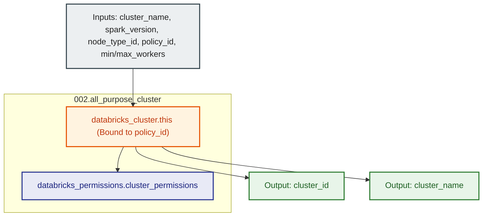

# Databricks All-Purpose Compute Cluster Module (`002.all_purpose_cluster`)

---

## 1. Executive Summary

- **Purpose & Scope**:
  This module provisions an all-purpose interactive compute cluster (`databricks_cluster`) within an individual Databricks workspace. It strictly enforces upstream policy adherence by requiring a `policy_id` parameter, establishes automatic scaling worker boundaries, configures inactivity auto-termination, and sets up role-based access controls (`databricks_permissions`).
- **Problem Statement & Solution**:
  Interactive clusters that lack policy enforcement can lead to configuration drift, oversized worker fleets, and high idle cloud compute costs. This module mandates that every cluster is tied to an upstream cluster policy, guarantees automatic shutdown after an idle period, and configures granular group-level permissions granting `CAN_MANAGE` to platform administrators and `CAN_RESTART` to team members.
- **Key Business & Security Outcomes**:
  - **Enforced Governance**: Guaranteed attachment to a validated cluster policy ID preventing unapproved configurations.
  - **Cost Minimization**: Strict inactivity autotermination and dynamic autoscaling minimize idle EC2 charges.
  - **RBAC Cluster Security**: Users can restart and attach to clusters without having permission to alter core configurations or node sizes.

---

## 2. General Logic & Operational Flow

### 2.1 Provisioning Lifecycle
1. **Cluster Specification**: Creates `databricks_cluster.this` configured with:
   - `spark_version`: Databricks Runtime (DBR) version.
   - `node_type_id`: EC2 instance type (must comply with the bound policy's allowlist).
   - `policy_id`: Upstream policy governing cluster constraints.
   - `autoscale`: Minimum and maximum worker node limits.
   - `autotermination_minutes`: Idle timeout before automatic shutdown.
   - `custom_tags`: Merges user-defined tags with `ManagedBy = "Terraform"`.
2. **Access Control List (ACL)**: Creates `databricks_permissions.cluster_permissions`:
   - `CAN_MANAGE`: Granted to `var.admin_group_name`.
   - `CAN_RESTART`: Granted to `var.user_group_name` (allowing developers to start/stop the cluster).
3. **Outputs**: Returns `cluster_id` and `cluster_name`.

---

## 3. Architecture of the Module

### 3.1 Resource Architecture & Attributes

| Resource Identifier | Resource Type | Description |
|:---|:---|:---|
| `databricks_cluster.this` | `databricks_cluster` | All-purpose interactive compute cluster bound to policy |
| `databricks_permissions.cluster_permissions` | `databricks_permissions` | Access control granting `CAN_MANAGE` to admins and `CAN_RESTART` to users |

---

## 4. Architecture C4 Visualisation

### 4.1 Level 2: Component Architecture Diagram

---

## 5. Terraform Documentation Interface

> [!NOTE]
> Machine-generated interface specifications for this module are maintained by `terraform-docs` in [`TERRAFORM.md`](./TERRAFORM.md).

### 5.1 Essential Inputs Summary

| Variable | Type | Description | Required |
|:---|:---:|:---|:---:|
| `cluster_name` | `string` | Name of the compute cluster | Yes |
| `spark_version` | `string` | Databricks Runtime (DBR) Spark version string | Yes |
| `node_type_id` | `string` | Worker node EC2 instance type ID | Yes |
| `policy_id` | `string` | ID of the cluster policy governing this cluster | Yes |
| `min_workers` | `number` | Minimum number of autoscaling workers | Yes |
| `max_workers` | `number` | Maximum number of autoscaling workers | Yes |
| `admin_group_name` | `string` | Name of the platform admin group (`CAN_MANAGE`) | Yes |
| `autotermination_minutes` | `number` | Inactivity minutes before auto-shutdown (default: `30`) | No |
| `user_group_name` | `string` | Name of the persona user group (`CAN_RESTART`) | No |
| `custom_tags` | `map(string)` | Custom tags attached to cluster | No |

### 5.2 Essential Outputs Summary

| Output | Type | Description |
|:---|:---:|:---|
| `cluster_id` | `string` | The unique ID of the provisioned cluster |
| `cluster_name` | `string` | The name of the provisioned cluster |

---

## 6. Important Links and References

- [Databricks Cluster Configuration Reference](https://docs.databricks.com/aws/en/compute/configure)
- [Databricks Cluster Resource Documentation](https://registry.terraform.io/providers/databricks/databricks/latest/docs/resources/cluster)
- [Databricks Cluster Permissions Documentation](https://registry.terraform.io/providers/databricks/databricks/latest/docs/resources/permissions)
- [Terraform Documentation Interface (`TERRAFORM.md`)](./TERRAFORM.md)
