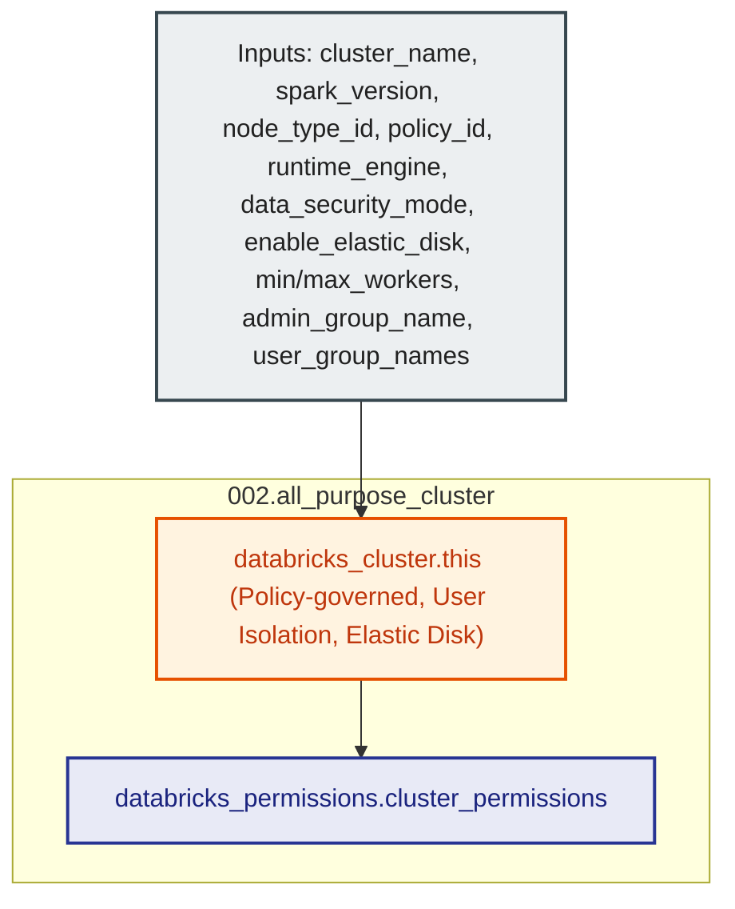

# Databricks All-Purpose Compute Cluster Module (`002.all_purpose_cluster`)

---

## 1. Executive Summary

- **Purpose & Scope**:
  This module provisions an all-purpose interactive compute cluster (`databricks_cluster`) within an individual Databricks workspace. It strictly enforces upstream policy adherence by requiring a `policy_id` parameter, establishes automatic scaling worker boundaries, configures inactivity auto-termination, enables autoscaling local storage (`enable_elastic_disk`), controls execution engine acceleration via `runtime_engine`, configures Unity Catalog access mode (`data_security_mode`), and sets up role-based access controls (`databricks_permissions`).
- **Problem Statement & Solution**:
  Interactive clusters that lack policy enforcement can lead to configuration drift, oversized worker fleets, out-of-disk failures during heavy shuffle operations, and high idle cloud compute costs. This module mandates that every cluster is tied to an upstream cluster policy, guarantees automatic shutdown after an idle period, enables autoscaling local storage (elastic disk) by default, defaults `runtime_engine` to `STANDARD` (explicitly disabling Photon overhead and additional DBU costs for general-purpose clusters unless explicitly opted in), sets `data_security_mode` to `USER_ISOLATION` for modern Unity Catalog governance, and configures granular group-level permissions granting `CAN_MANAGE` to platform administrators and `CAN_RESTART` to authorized user groups.
- **Key Business & Security Outcomes**:
  - **Enforced Governance**: Guaranteed attachment to a validated cluster policy ID preventing unapproved configurations.
  - **Storage Resilience**: Autoscaling local storage (`enable_elastic_disk = true`) dynamically provisions EBS volumes to absorb large data shuffles and spills without job failures.
  - **Cost Minimization**: Strict inactivity autotermination, dynamic autoscaling, and standard runtime execution minimize unnecessary DBU and EC2 charges.
  - **Security & Unity Catalog Access**: Defaults to `USER_ISOLATION` to support multi-user Unity Catalog data governance while preventing deprecated or non-isolated cluster setups.
  - **RBAC Cluster Security**: Accepts a list of authorized user groups (`user_group_names`) granted `CAN_RESTART` and `CAN_ATTACH_TO`, while strictly restricting `CAN_MANAGE` to a single platform admin group (`admin_group_name`).

---

## 2. General Logic & Operational Flow

### 2.1 Provisioning Lifecycle
1. **Cluster Specification**: Creates `databricks_cluster.this` configured with:
   - `spark_version`: Databricks Runtime (DBR) version.
   - `node_type_id`: EC2 instance type (must comply with the bound policy's allowlist).
   - `policy_id`: Upstream policy governing cluster constraints.
   - `runtime_engine`: Execution engine (`STANDARD` or `PHOTON`, defaulting to `STANDARD`).
   - `data_security_mode`: Unity Catalog access mode (`USER_ISOLATION` or `SINGLE_USER`, defaulting to `USER_ISOLATION`).
   - `single_user_name`: Target user identity when operating in `SINGLE_USER` mode.
   - `enable_elastic_disk`: Autoscaling local storage enabled (`true` by default).
   - `autoscale`: Minimum and maximum worker node limits.
   - `autotermination_minutes`: Idle timeout before automatic shutdown.
   - `custom_tags`: Merges user-defined tags with `ManagedBy = "Terraform"`.
2. **Access Control List (ACL)**: Creates `databricks_permissions.cluster_permissions`:
   - `CAN_MANAGE`: Granted to single `var.admin_group_name`.
   - `CAN_RESTART`: Iterates dynamically over `var.user_group_names` (granting developer groups permission to start/stop and attach to the cluster).

---

## 3. Architecture of the Module

### 3.1 Resource Architecture & Attributes

| Resource Identifier | Resource Type | Description |
|:---|:---|:---|
| `databricks_cluster.this` | `databricks_cluster` | All-purpose interactive compute cluster bound to policy with autoscaling storage and Unity Catalog isolation |
| `databricks_permissions.cluster_permissions` | `databricks_permissions` | Access control granting `CAN_MANAGE` to single admin group and `CAN_RESTART` to user groups |

---

## 4. Architecture C4 Visualisation

### 4.1 Level 2: Component Architecture Diagram

---

## 5. All Modules Used with Short Summaries

This module does not invoke external submodules. It provisions native Databricks cluster and permissions resources directly within the target workspace.

- **Consumers**:
  - [`004.workspace_compute`](file:///modules/05.compute/004.workspace_compute) - Workspace compute orchestrator invoking this module via `for_each` across defined cluster configurations.

---

## 6. Terraform Documentation Interface

> [!NOTE]
> Machine-generated interface specifications for this module are maintained by `terraform-docs` in [`TERRAFORM.md`](./TERRAFORM.md).

### 6.1 Essential Inputs Summary

| Variable | Type | Description | Required |
|:---|:---:|:---|:---:|
| `cluster_name` | `string` | Name of the compute cluster | Yes |
| `spark_version` | `string` | Databricks Runtime (DBR) Spark version string | Yes |
| `node_type_id` | `string` | Worker node EC2 instance type ID | Yes |
| `policy_id` | `string` | ID of the cluster policy governing this cluster | Yes |
| `admin_group_name` | `string` | Single platform admin group name (`CAN_MANAGE`) | Yes |
| `min_workers` | `number` | Minimum number of autoscaling workers | Yes |
| `max_workers` | `number` | Maximum number of autoscaling workers | Yes |
| `runtime_engine` | `string` | Execution engine type (`STANDARD` or `PHOTON`, default: `STANDARD`) | No |
| `data_security_mode` | `string` | Unity Catalog access mode (`USER_ISOLATION` or `SINGLE_USER`, default: `USER_ISOLATION`) | No |
| `single_user_name` | `string` | Username for single-user clusters when mode is `SINGLE_USER` | No |
| `enable_elastic_disk` | `bool` | Whether autoscaling local storage is enabled (default: `true`) | No |
| `autotermination_minutes` | `number` | Inactivity minutes before auto-shutdown (default: `30`) | No |
| `user_group_names` | `list(string)` | List of group names granted permissions (`CAN_RESTART`) (default: `[]`) | No |
| `custom_tags` | `map(string)` | Custom tags attached to cluster | No |

### 6.2 Essential Outputs Summary

No outputs are exported by this module. Clusters are provisioned and managed directly as internal workspace compute resources.

---

## 7. Important Links and References

- [Databricks Cluster Configuration Reference](https://docs.databricks.com/aws/en/compute/configure)
- [Databricks Cluster Resource Documentation](https://registry.terraform.io/providers/databricks/databricks/latest/docs/resources/cluster)
- [Databricks Cluster Permissions Documentation](https://registry.terraform.io/providers/databricks/databricks/latest/docs/resources/permissions)
- [Terraform Documentation Interface (`TERRAFORM.md`)](./TERRAFORM.md)
