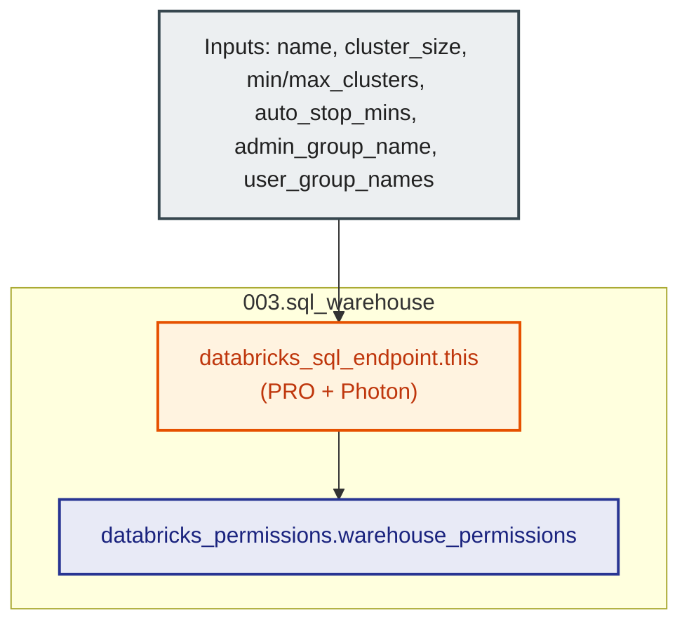

# Databricks SQL Warehouse Module (`003.sql_warehouse`)

---

## 1. Executive Summary

- **Purpose & Scope**:
  This module provisions high-performance, cost-optimized Databricks SQL Warehouses (`databricks_sql_endpoint`) within a workspace. It configures cluster sizing, multi-cluster autoscaling, automatic suspension after inactivity (`auto_stop_mins`), and binds role-based access control (`databricks_permissions`) granting `CAN_MANAGE` to a single administrator group and `CAN_USE` to authorized analytics user groups.
- **Problem Statement & Solution**:
  Running general-purpose all-purpose clusters for BI queries and ad-hoc dashboards results in slow query startup, sub-optimal SQL caching, and excessive DBU burn. SQL Warehouses provide specialized T-shirt sized SQL execution engines (`2X-Small` to `4X-Large`) optimized for BI tools (Power BI, Tableau) and Lakeview dashboards, complete with instant query caching and auto-stop capabilities.
- **Key Business & Security Outcomes**:
  - **Inactivity Protection**: Automatically suspends warehouses after a configurable idle threshold (e.g., 15 minutes) to eliminate runaway compute costs.
  - **Elastic Concurrency**: Supports multi-cluster horizontal autoscaling (`min_num_clusters` to `max_num_clusters`) to accommodate peak reporting demands without query queueing.
  - **Engine Performance**: Enforces the high-performance **PRO** warehouse type with **Photon** acceleration enabled.
  - **Future-Proof Serverless Transition**: Pre-wired with `enable_serverless_compute` (default `false`) allowing immediate zero-downtime transition to Serverless SQL once workspace serverless terms and networking prerequisites are accepted.
  - **RBAC Warehouse Governance**: Supports multiple authorized user groups (`user_group_names`) receiving query execution capabilities (`CAN_USE`), while restricting administrative operations to a single platform admin group (`admin_group_name`).

---

## 2. General Logic & Operational Flow

### 2.1 Provisioning Lifecycle
1. **Warehouse Instantiation**: Provisions `databricks_sql_endpoint.this` with:
   - `cluster_size`: T-shirt sizing (`2X-Small`, `X-Small`, `Small`, `Medium`, etc.).
   - `min_num_clusters` & `max_num_clusters`: Autoscaling concurrency scaling bounds.
   - `auto_stop_mins`: Inactivity threshold triggering warehouse suspension.
   - `warehouse_type`: Enforced to `PRO` (`CLASSIC` is rejected via validation).
   - `enable_photon`: Enforced to `true` for vectorized execution.
   - `enable_serverless_compute`: Toggles Databricks serverless compute plane (`false` for customer compute, ready to switch to `true` for Serverless SQL).
   - `tags`: Custom metadata key-value tags.
2. **Access Control List (ACL)**: Creates `databricks_permissions.warehouse_permissions`:
   - `CAN_MANAGE`: Granted to single `var.admin_group_name`.
   - `CAN_USE`: Dynamically iterates over list `var.user_group_names`.

---

## 3. Architecture of the Module

### 3.1 Resource Architecture & Attributes

| Resource Identifier | Resource Type | Description |
|:---|:---|:---|
| `databricks_sql_endpoint.this` | `databricks_sql_endpoint` | Databricks SQL Warehouse endpoint with auto-stop and Photon |
| `databricks_permissions.warehouse_permissions` | `databricks_permissions` | Access control granting `CAN_MANAGE` to single admin and `CAN_USE` to user groups |

---

## 4. Architecture C4 Visualisation

### 4.1 Level 2: Component Architecture Diagram

---

## 5. Terraform Documentation Interface

> [!NOTE]
> Machine-generated interface specifications for this module are maintained by `terraform-docs` in [`TERRAFORM.md`](./TERRAFORM.md).

### 5.1 Essential Inputs Summary

| Variable | Type | Description | Required |
|:---|:---:|:---|:---:|\n| `name` | `string` | Name of the SQL Warehouse | Yes |\n| `admin_group_name` | `string` | Single platform admin group name (`CAN_MANAGE`) | Yes |\n| `cluster_size` | `string` | T-shirt size (`2X-Small`, `X-Small`, `Small`, etc., default: `"2X-Small"`) | No |\n| `min_num_clusters` | `number` | Minimum number of clusters (default: `1`) | No |\n| `max_num_clusters` | `number` | Maximum number of clusters for autoscaling (default: `1`) | No |\n| `auto_stop_mins` | `number` | Inactivity minutes before automatic suspension (default: `15`) | No |\n| `warehouse_type` | `string` | Warehouse engine type: only `"PRO"` is supported (default: `"PRO"`) | No |\n| `enable_photon` | `bool` | Whether Photon acceleration is enabled (enforced `true`, default: `true`) | No |\n| `enable_serverless_compute` | `bool` | Enable Serverless compute backend (default: `false`) | No |\n| `user_group_names` | `list(string)` | List of user group names granted access (`CAN_USE`) (default: `[]`) | No |\n| `tags` | `map(string)` | Tags attached to warehouse | No |\n\n---\n\n## 6. Important Links and References\n\n- [Databricks SQL Warehouses Reference](https://docs.databricks.com/aws/en/sql/admin/sql-endpoints)\n- [Databricks SQL Endpoint Resource Documentation](https://registry.terraform.io/providers/databricks/databricks/latest/docs/resources/sql_endpoint)\n- [Databricks Permissions Resource Documentation](https://registry.terraform.io/providers/databricks/databricks/latest/docs/resources/permissions)\n- [Terraform Documentation Interface (`TERRAFORM.md`)](./TERRAFORM.md)\n
