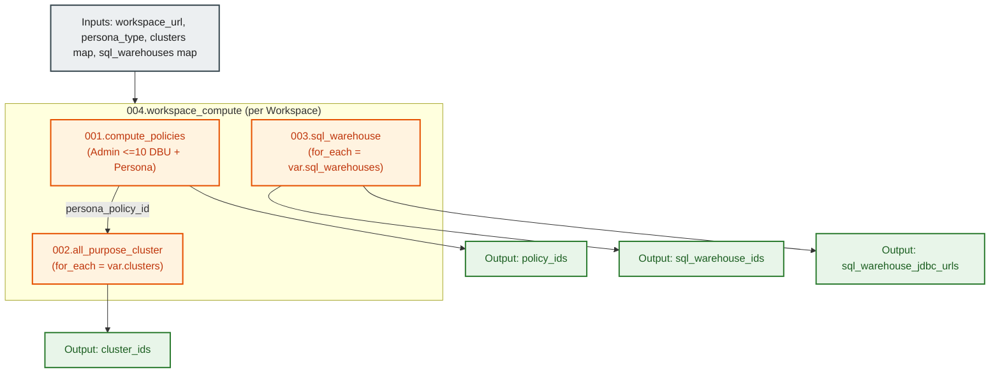

# Databricks Workspace Compute Orchestration Module (`004.workspace_compute`)

---

## 1. Executive Summary

- **Purpose & Scope**:
  This composite module orchestrates the complete in-workspace compute ecosystem for a dedicated Databricks persona workspace. It unifies compute policy governance ([`001.compute_policies`](file:///modules/05.compute/001.compute_policies)), all-purpose interactive clusters ([`002.all_purpose_cluster`](file:///modules/05.compute/002.all_purpose_cluster)), and SQL Warehouses ([`003.sql_warehouse`](file:///modules/05.compute/003.sql_warehouse)) into a single parameterized module declaration instantiated once per workspace.
- **Problem Statement & Solution**:
  Declaring individual cluster resources and policies directly at the root environment level leads to repetitive HCL configurations across multiple persona workspaces (Data Engineering, Data Science, Data Analytics). This composite module abstracts this complexity by accepting maps of cluster and warehouse definitions, automatically deploying the capped Platform Admin policy (max 10 DBU) alongside the persona-specific policy, and binding every provisioned cluster directly to its designated policy ID.
- **Key Business & Security Outcomes**:
  - **Single Point of Orchestration**: Environments instantiate this single module per workspace to provision all policies, clusters, and warehouses.
  - **Automated Policy Binding**: Dynamically looks up the policy ID matching the workspace persona (`data_engineering`, `data_science`, `data_analytics`) and assigns it to all declared clusters.
  - **Scalable Map Architecture**: Supports provisioning zero, one, or multiple clusters and SQL endpoints per workspace without code changes.

---

## 2. General Logic & Operational Flow

### 2.1 Provisioning Lifecycle
1. **Compute Policies Deployment**: Instantiates `module.compute_policies` creating the capped Platform Admin policy (max 10 DBU) and the persona policy corresponding to `var.persona_type`.
2. **Policy Lookup Resolution**: Computes `local.persona_policy_map` mapping the persona key to its active policy ID output.
3. **Cluster Fleet Provisioning**: Uses `for_each = var.clusters` to invoke `module.clusters`, binding each cluster to `local.persona_policy_map[var.persona_type]`.
4. **SQL Warehouses Provisioning**: Uses `for_each = var.sql_warehouses` to invoke `module.sql_warehouses`, configuring T-shirt sizing and inactivity auto-stop.
5. **Outputs Aggregation**: Consolidates policy IDs, cluster IDs, SQL Warehouse IDs, and JDBC connection strings.

---

## 3. Architecture of the Module

### 3.1 Submodules Invoked

| Submodule | Source | Role & Responsibility |
|:---|:---|:---|
| `module.compute_policies` | `../001.compute_policies` | Creates capped admin policy (max 10 DBU) and persona policy |
| `module.clusters` | `../002.all_purpose_cluster` | Instantiates policy-bound interactive clusters via `for_each` |
| `module.sql_warehouses` | `../003.sql_warehouse` | Instantiates auto-stopping SQL Warehouses via `for_each` |

---

## 4. Architecture C4 Visualisation

### 4.1 Level 2: Component Architecture Diagram

---

## 5. Terraform Documentation Interface

> [!NOTE]
> Machine-generated interface specifications for this module are maintained by `terraform-docs` in [`TERRAFORM.md`](./TERRAFORM.md).

### 5.1 Essential Inputs Summary

| Variable | Type | Description | Required |
|:---|:---:|:---|:---:|
| `workspace_url` | `string` | The target workspace URL passed from the workspace module | Yes |
| `admin_group_name` | `string` | Name of the platform admin group | Yes |
| `persona_group_name` | `string` | Name of the persona group (e.g. data_engineers) | Yes |
| `persona_type` | `string` | `data_engineering`, `data_science`, or `data_analytics` | Yes |
| `clusters` | `map(object)` | Map of compute cluster configuration objects | No |
| `sql_warehouses` | `map(object)` | Map of SQL Warehouse endpoint configuration objects | No |

### 5.2 Essential Outputs Summary

| Output | Type | Description |
|:---|:---:|:---|
| `policy_ids` | `map(string)` | Map of policy IDs created for the workspace |
| `cluster_ids` | `map(string)` | Map of cluster keys to provisioned cluster IDs |
| `sql_warehouse_ids` | `map(string)` | Map of SQL Warehouse keys to provisioned warehouse IDs |
| `sql_warehouse_jdbc_urls` | `map(string)` | Map of SQL Warehouse keys to JDBC connection URLs |

---

## 6. Important Links and References

- [Compute Policies Module (`001.compute_policies`)](file:///modules/05.compute/001.compute_policies)
- [All-Purpose Cluster Module (`002.all_purpose_cluster`)](file:///modules/05.compute/002.all_purpose_cluster)
- [SQL Warehouse Module (`003.sql_warehouse`)](file:///modules/05.compute/003.sql_warehouse)
- [Terraform Documentation Interface (`TERRAFORM.md`)](./TERRAFORM.md)
